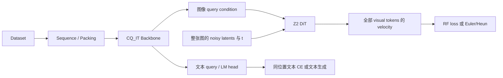

# UMM v3

围绕 **CQ_IT backbone + 固定 condition + 全图 Z2 DiT flow** 的独立重构。
运行时不导入旧仓库，不需要安装 `unified_mm_v2`。来源仅为 `unified-mm` 的
`origin/npu`，固定提交 `193ec90300af5fee4bc4b7e8a426492a908a0447`。

**当前代码是 Z2 的迁移实现，最佳实验版本尚待确认。**
重构方案、源码指纹和基线复核证据见 [迁移记录](docs/migration.md)。

本版保留选定路线的纯文本、T2I、I2T 训练，整图 flow 采样、文本 KV-cache
生成、图像 packing、checkpoint/EMA、生成和理解评分。历史架构消融没有搬入。
视频时空位置编码、视频 codec 和视频数据协议尚未实现；当前输入为完整方形图像网格。

## 架构审核后的调整

| 原实现/原方案 | v3 落点与职责 |
|---|---|
| `modeling_selfless_flow.py` 中的主干、目标与采样相互依赖 | `models/backbone.py` 只产生 content/query 状态；loss 和采样移到各自模块 |
| JointDiT 通过父模型继承保留多个历史 head 分支 | `models/generator.py` 只保留 Z2；`modeling_umm.py` 显式组装 backbone、condition projector、generator、lm_head |
| 大训练脚本同时处理构造、数据和更新 | `training/train.py` 构造对象；`trainer.py` 管累积、更新、验证、保存；`loss.py` 定义目标 |
| 数据读取和序列/packing 混在一起 | `data/dataset.py` 读取，`sequence.py` 序列化，`packing.py` 批处理，`dataloader.py` 调度和消费游标 |
| 各评估脚本分别调用模型 | `evaluations/eval.py` 统一入口，复用同一 loss、sampler 和 codec |
| 方案中两个 `checkpoint.py` | 只保留 `utils/checkpoint.py`；训练 EMA 放在 `training/ema.py` |
| 全局配置解析与实验参数 | `configs/config.py` 负责默认值、合并与校验；实验参数放在同目录 YAML |

组件没有通用插件注册系统。组装处提供 `build_backbone`、`build_generator` 和构造器注入；
以后增加实现时只扩展明确的组件接口。本版配置只接受已迁移并验证的 `cq_it/z2`，
不会把未经实现的架构名称静默回退到默认模型。

```text
UMM_v3/
  models/
    modeling_umm.py        UMMConfig、组件组装、预测接口
    backbone.py            CQ_IT / Qwen、content KV cache
    generator.py           Z2 DiT、时间嵌入、基础 block
    codec.py               KL16 编解码、posterior 缓存协议
    sampling.py            全图 Euler/Heun、CFG
    position.py            文本/图像二维位置
    initialization.py      参数初始化
    text_generation.py     同位置 query 文本生成
  data/
    dataset.py             posterior、class/caption 样本
    manifest.py            图像/caption 身份匹配
    cache.py               mmap shard 与文本索引读取
    sequence.py            序列布局和 sigma
    packing.py             collate、padding、segment packing
    text_dataset.py        在线文本流与恢复状态
    text_validation.py     固定文本验证集与排除清单
    dataloader.py          混合任务调度、已消费游标
  training/
    train.py               配置/模型/数据/优化器初始化
    trainer.py             更新循环与训练状态
    loss.py                RF / 同位置文本 CE
    optimizer.py           参数分组、AdamW、WSD
    ema.py                 分片 FP32 EMA
  evaluations/
    eval.py                CLI
    validation.py          训练目标验证与状态隔离
    generation.py          joint 采样、FID/IS 汇总
    understanding.py       PPL、选择题、分类、检索评分
    metrics.py             来源实现的 Inception/FID/IS 数学
  utils/
    attention_mask.py      CQ 可见性、CFG、segment 隔离
    checkpoint.py          完整恢复、原子保存、权重导出
    weights.py             旧权重映射及兼容性校验
    distributed.py         跨 rank I/O 错误同步
  configs/
    config.py              默认参数、YAML 合并、参数约束
    image.yaml             纯 T2I 配置
    unified.yaml           文本、T2I、I2T 混合配置
    accelerate/            单进程与 ZeRO-2 模板
  scripts/                 训练/评估入口、生成、cache/权重转换
  docs/
    migration.md           重构方案、源码来源与基线复核
    validation.md          历史验证环境、结果与验收边界
  tests/                   数值、数据、恢复、分布式、CLI 验证
```

功能模块按职责归入 `models/`、`data/`、`training/`、`evaluations/`、`utils/` 和 `configs/`；
跨目录导入使用 `from models...`、`from configs.config...` 等路径。
更新旧 checkout 后需重新执行 `python -m pip install -e '.[dev]'`，刷新可编辑安装的模块路径。

## 核心数据流



1. **CQ 分离**：content 和 query 是两套 hidden states，共享 Qwen 参数。
   K/V 只由 content 构造；query 不写入 K/V，也不互相读取。
   content 可读 `sigma_key <= sigma_query`，query 可读严格的 `<`。
   图像内部 sigma 相同，因此图像 query 不能读取目标图像的真实 content。
   BOI/EOI 的顺序、padding、segment、CFG 由统一 mask 实现。
2. **backbone → generator**：`encode_condition(batch)` 输出 `[M,N,H]`，
   `generator(x_t, t, condition)` 输出 `[M,N,D]`。M 是目标图像数，
   N 是一张图的 latent token 数。一个 ODE 步更新所有 N 个 token；
   “同时生成”不等于只有一个 ODE 步。CFG 将有条件/无条件分支合批，backbone 只调用一次。
3. **Z2 的条件注入**：该固定源码版本的 Z2 使用 noisy-token 双向 self-attention，
   通过每个位置的 condition 和时间嵌入调制 AdaLN。
   它不是旧版逐 token、读取 clean-content K/V 的 cross-attention flow head。
   因此本文按实际 Z2 代码命名，不能将前期讨论中的“x-attn DiT”直接当作该实现的等价描述。
   Joint 描述整张图像共享时间、跨 token attention 的联合生成方式；Z2 是实现这种方式的具体网络。
   当前只有一个 generator，二者不是两个并列的模型选项。
4. **训练目标**：`x_t=(1-t)*noise+t*clean`，预测 `clean-noise`；
   同一图像共享 t，文本采用 query 所在位置的 CE，不进行普通 causal LM 的标签平移。
   默认 schedule 为 `text,t2i,text,i2t`，每 4 个 microbatch 更新一次。
   每个 microbatch 的加权 mean loss 按 GA 缩放；日志里的 token mean 单独计算。
   `joint` 任务则在一次 backbone 前向后同时输出文本 logits 和图像 velocity，计算
   `lambda_text * CE + lambda_image * Flow`，两项分别按有效文本标签和图像监督 mask 归一化。
   `data.image.caption_sequence_modes: [t2i, i2t]` 沿用原数据集的按样本/epoch 选任务规则，
   允许同一 batch 混合两类样本；某个 batch 只有一种有效监督时，另一项为零。
   自定义 batch 也可在同一序列提供两类监督，或通过 `compute_text_loss/compute_image_loss` 分别启停。
5. **Qwen 权重与 mask 初始化**：`CQITBackbone` 对应 Qwen 的 model 部分；外层唯一的
   `lm_head` 加载 Qwen 原有输出权重，启用 `tie_word_embeddings` 时与输入 embedding 绑权。
   `model.image_mask_init` 默认 `copy_text`：新增 image mask token 时复制 text mask embedding，
   与原版一致；`random` 使用独立随机初始化，供对照实验。两种方式的 token ID 和参数行都独立。
   完整 UMM 权重加载或训练恢复保留已学习的 embedding，不重新应用初始化策略。

`batch` 的公共字段为 `input_ids/token_types/sigma/segment_ids/labels` `[B,L]`、
`position_ids` `[2,B,L]`、`image_latents` `[B,L,D]`、`image_latent_mask/image_loss_mask` `[B,L]`、
`image_span_table` `[M,5]`（row、segment、start、end、image id）及 `task`。
token type 依次为 text=0、image=1、special=2、padding=3。训练阶段的
`content_image_latents` 是独立输入扰动，不能覆盖 RF 的 clean target，也不能带入推理。

## 安装与配置

先安装设备对应的 PyTorch；Ascend 另需相匹配的 `torch_npu` 和 DeepSpeed。
以下命令在本目录执行：

```bash
python3 -m venv .venv
source .venv/bin/activate
python -m pip install -e '.[dev]'
# 需要 FID/IS 时：python -m pip install -e '.[evaluation]'
# 使用 ZeRO-2 时：python -m pip install -e '.[distributed]'
```

`configs/unified.yaml` 对应文本+T2I+I2T；`configs/image.yaml` 对应纯 T2I。
参数默认值集中在 `configs/config.py`，无需在每份 YAML 重复。把 `/assets/...` 替换为本地路径。
路径相对启动工作目录解析；不会自动下载模型、语料、VAE 或 Inception 权重。
本次 CPU 测试版本见 `requirements-cpu-tested.txt`，它是复现记录，不能替代 NPU 平台依赖。

```bash
python -m training.train --config configs/unified.yaml --dry-run
bash scripts/train.sh --config configs/unified.yaml
# 同一 backbone 前向内联合监督；data.sources.joint 可单独设置 batch size/workers：
bash scripts/train.sh --config configs/unified.yaml \
  --set 'data.schedule=[joint]' --set training.gradient_accumulation_steps=1 \
  --set training.output_dir=output/joint
# mask 初始化对照实验（仅影响新增的 image mask）：
# --set model.image_mask_init=random
# 按实际设备拓扑编辑 zero2.yaml 后使用：
ACCELERATE_CONFIG=configs/accelerate/zero2.yaml bash scripts/train.sh --config configs/unified.yaml
# 同一运行配置、数据与 world size 下恢复：
bash scripts/train.sh --config output/unified-z2/config.yaml --resume output/unified-z2/checkpoint-2000
```

`--set section.key=value` 可覆盖配置。`--dry-run` 只做静态配置校验。
恢复要求完整 optimizer 边界，保存模型、optimizer、scheduler、随机状态、EMA、
每 rank 数据游标与任务位置。loader 预取不推进保存游标；仅已成功消费的 batch 提交状态。
配置/world size 不一致会拒绝精确恢复；仅 `image_mask_init` 作为已失效的初始化选项不参与恢复比较，
兼容尚未记录这个字段的 v3 checkpoint。旧仓库 optimizer 状态不迁移，旧模型可转换后重新建立优化器。
训练日志为 `output_dir/metrics.jsonl`；不依赖在线实验追踪服务。
联合任务的 `train/loss_joint`、`val/loss_joint` 表示加权 microbatch 均值；`loss_joint_text`、`loss_joint_image`
分别表示有效文本/图像 token 的原始损失均值，并报告各自 target 数量。二者不会合并成一个 token 分母。
当各 batch 的监督数量不同，token 均值的加权和不必等于 microbatch 目标均值。

## 数据与权重迁移

图像支持来源的 merged posterior `.pt` 和 lazy shard index `.json`；
缓存必须保存缩放后的 mean/std，不能用一次抽样后冻结的 latent 替代。
manifest 每行含 `img_id/synset/source_path/split`，训练与验证身份必须独立。
caption JSONL 按 image id/路径严格匹配；两个示例配置均显式设置训练和验证各自的
`synthetic_text_index_manifest`，对应原二进制 seek 索引：T2I 读取独立生成 prompt，I2T 读取 caption。
这些 manifest 及其引用的 caption/prompt JSONL、offset、mapping 文件需一起迁移并修改路径。
自定义配置省略该索引时，数据集仍支持用 caption 同时提供 T2I 文本；这不等同于原索引配方。
纯 class conditioning 需要 `synset_mapping_path`；I2T 需要 caption conditioning。
文本采用 ClimbMix JSONL 的 `text` 字段。验证使用独立 JSONL，或固定 manifest
配合 `validation_exclusion_manifest` 排除训练中的预留记录。

```bash
python scripts/convert_checkpoint.py --input /assets/source-z2-hf --output output/z2-weights.pt
python scripts/prepare_latents.py --manifest /assets/imagenet/train.jsonl \
  --output /assets/imagenet/train-cache --module-root /assets/mar \
  --checkpoint /assets/mar/kl16.ckpt --device cpu
```

新生成 cache 的 `index.json` 可直接作为 `data.image.cache_path`。
工具逐批编码、逐 shard 保存，按原版短边 Bicubic Resize → CenterCrop → ToTensor →
Normalize(0.5, 0.5) 处理，尺寸截断和中心裁剪取整也与原规则一致，不使用额外 BOX 下采样。
脚本输出 [0,1] 像素，Normalize 在 codec 中执行一次；metadata 标为 `bicubic_resize_center_crop_v1`。
迁移对照应优先复用来源的现有缓存，避免把重新预处理的数据差异混入架构验证。
权重映射为 `model.* → backbone.*`、`image_flow_condition_proj.* → condition_projector.*`、
`image_flow_head.net.* → generator.*`；缺失参数、冲突绑权和不兼容 head 会报错。
导出的 `weights.pt/weights-ema.pt` 用于推理；`checkpoint-N/` 用于恢复训练。

`training.trainable_scope=generator` 与原版 `flow_head_only` 一致：只训练
`generator` 和 `condition_projector`，冻结整个 backbone，包括图像输入投影。
学习率仍将两种投影分在 `projector` 组；学习率分组不决定解冻范围。
训练按 `seed + rank` 初始化随机数，checkpoint 保存各 rank 的随机状态。
图像输入先转为实际 input projector 参数的 dtype，再添加扰动；flow 监督目标保留干净 posterior。
EMA 在 `accelerator.prepare()` 完成后建立参数元数据，使用最终参数类型校验并以 FP32 保存影子权重。

## 生成与评估

```bash
python scripts/generate.py --config output/unified-z2/config.yaml \
  --checkpoint output/unified-z2/weights-ema.pt --prompt 'a red bird on a branch' \
  --output output/sample --device cpu
# 不加载 VAE，只生成 visual tokens：在上面的命令追加 --latents-only
bash scripts/evaluate.sh --config output/unified-z2/config.yaml \
  --checkpoint output/unified-z2/weights-ema.pt --task loss --output output/loss.json
bash scripts/evaluate.sh --config output/unified-z2/config.yaml \
  --checkpoint output/unified-z2/weights-ema.pt --task perplexity --source text --output output/ppl.json
```

`loss` 验证沿用来源的 `train()+no_grad()` 协议，包含 CFG dropout 和图像输入扰动，
验证前后恢复随机状态和各子模块 mode。纯 PPL/理解评分与生成使用 eval mode。
训练内验证和独立 `--task loss` 共用 `evaluation.seed`（默认 424242）、
验证集和每任务 batch 划分。默认 `evaluation.loss_image_per_class=2`，
ImageNet-val 从每类固定抽取两张，共 2,000 张，选取和排列顺序与原版一致。
`evaluation.image_classes` 指向原项目的 `imagenet1k_synthetic_v1/t2i/classes.json`；
示例配置将其映射为 `/assets/imagenet/classes.json`，可直接改为原文件的实际路径。
`text/t2i/i2t` 的 batch 种子为 `evaluation.seed + 0/1000003/2000006 + 本任务batch序号`；
可选 joint 流使用独立偏移 3000009。分布式按每个任务的全局 batch 序号分配，
启用 packing 时 loss 验证复用训练 collator。生成评估和独立 PPL 保留完整验证集。
需要显式评估全量 loss 时可设置 `evaluation.loss_image_per_class=null`，该协议不同于默认原版小验证集。
诊断上限使用 `evaluation.max_batches`，未设置时沿用 `training.validation_max_batches`；默认不截断。
`--task generation` 额外需要 `codec`、Inception 权重和真实图像 FID 统计配置。
选择题、分类与检索使用 `--batches` 提供冻结候选的 torch bundle，评分约定见
`evaluations/understanding.py`；此版本未附带外部 benchmark 的下载和全套数据转换器。

FID 统计通过 `evaluation.real_stats_path` 或 `evaluation.reference_statistics` 指定。
可直接读取原仓库的 `imagenet_inception_feature_moments_v1` / 
`imagenet_val_inception_feature_moments_v2` 文件：保留 `stats.count/sum/outer_sum`，
校验 ImageNet-val 50,000 张、1000 类、Inception extractor、缩放/裁剪和累加 dtype。
也支持 `.pt` 中的 `mean/covariance` 及 `.npz` 中的 `mu/sigma`；这些通用统计不会被标记为
已验证的正式 ImageNet 参考集。Inception 权重使用 `evaluation.inception_weights` 或原名
`evaluation.inception_weights_path`。报告记录 checkpoint 路径；已加载模型的权重标记为
`provided_model`，只有在评估中显式安装 EMA 时才标记为 `ema`，避免把 EMA 导出误标为 raw。

候选 bundle 用 `torch.save({...}, path)` 保存。`batches` 是 batch 字典列表；公共模型字段
遵循上文 `batch` 协议，`task` 为 `text` 或 `i2t`，`labels` 与被预测 token 位于同一位置，
上下文标为 `-100`。每行至少包含一个目标 token；不同候选各占一行，不能只提供正确选项。

| `--task` | 每个 batch 的额外字段（每行一个值） | bundle 顶层额外字段 |
|---|---|---|
| `choices` | `question_ids`、从 0 连续编号的 `choice_ids`、正整数 `normalization_chars` | `answers`：question id 到正确 choice id 的映射 |
| `classification` | `image_indices`、`text_indices` | `image_count`、`text_count`、`labels`（每幅图对应的类别索引） |
| `retrieval` | `image_indices`、`text_indices` | `image_count`、`text_count`、`image_ids`、`text_image_ids`（后者允许同一图像对应多段文本） |

选择题同时报告总 log-likelihood 和按**原选项字符数**归一化的 accuracy；`normalization_chars`
不能替换为 tokenizer 的 token 数。分类和检索使用平均 token log-likelihood，并减去每个文本在
完整候选图像集合上的 `logmeanexp` 语言先验（固定 alpha=1）。image/text 索引必须完整覆盖
`image_count × text_count`，重复或缺失组合会报错。需要 MMLU subject 宏平均、WinoGrande
专用 continuation 或其他官方 benchmark prompt 时，应在资产适配层实现相应 recipe；
当前通用评分入口不等同于迁移了这些 benchmark 的完整评估协议。

## 验证与交付边界

```bash
OMP_NUM_THREADS=1 MKL_NUM_THREADS=1 python -m pytest tests -q
python -m ruff check .
# 可选：与固定来源快照直接对照数据字段，运行时不需要这个快照。
UMM_SOURCE_SNAPSHOT=/path/to/193ec90-snapshot python -m pytest tests/test_data_source_parity.py -q
```

测试覆盖原数值算式、backbone/DiT 梯度、CQ 泄漏隔离、CFG/solver、文本缓存、
数据预取与恢复、混合梯度累积、真实小模型训练/评估/转换 CLI、分片 EMA 与事务 checkpoint。
新增回归覆盖同一序列的联合 CE/flow 及梯度、joint 数据加载/恢复/评估、独立 prompt 来源、
原生 Qwen 分片权重与两种 mask 初始化、奇数尺寸裁剪和 posterior 编码。
训练对齐回归还覆盖 FP16 cache 在 FP32/BF16 投影下的原版加噪与后续 RF 随机序列、
原版冻结范围、类别索引含两位数时的验证集顺序、训练内/独立验证指标一致性，
以及 CPU 模拟后端 BF16 转换后的真实训练入口和 EMA 恢复。
双 rank Gloo 检查使用 rank 独立全局随机数，并核对分布式验证与单进程结果。
直接调用原版 torchvision 变换的对照测试需要安装 evaluation 可选依赖中的 torchvision；
未安装时仅跳过该项，固定像素场景和 posterior 编码测试仍会执行。
参考模型类体固定在 `tests/reference/pinned_model.py`；数据对照快照由环境变量显式提供。
历史验证快照记录于 [验证记录](docs/validation.md)。CPU 小模型验证不证明完整模型的 FID/IS、
吞吐或显存等价。GPU/NPU、真实 KL16/Inception 资产和正式训练质量仍需设备环境验收。

实施顺序、验收项、源码文件指纹和基线选择证据见 [迁移记录](docs/migration.md)。
