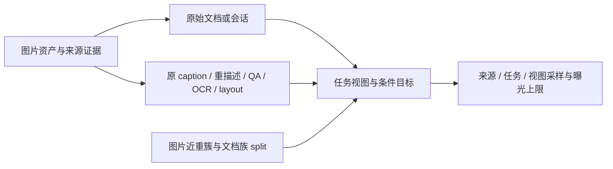

# gen-und + DCVLM：统一多模态预训练语料核验与构建建议

> 2026-10-22 更新：本文中 T2I50 的实测计数是历史审计结果。用户已退役该派生版；当前 DCVLM 使用原版 v1 并保留原生类型，T2I 仅从 gen-und 构建。最新入口与验证见 `corpus_pipeline/README.md`、`corpus_pipeline/VALIDATION.md`。

> 管道目标补充：输入一个数据集后，自动探测并调用 API 识别、选择适用处理流程；最终交付原图引用、筛选索引和新增标注，原集只读且默认不复制图片。存储预算、跨分区读取与实现边界见 [总体架构设计](corpus_pipeline/PIPELINE_DESIGN.md)，layout 细则见 [layout 阶段设计](corpus_pipeline/LAYOUT_PIPELINE_PLAN.md)。两份文件为后续设计，不代表自动流程已经运行。

核验日期：2026-10-22（北京时间；证据中的 UTC 时间为 10 月 21 日）。目标是排除 AI 生成图像，形成 T2I、I2T、单轮、多轮、真实交错序列，并补充 MOSS-style layout JSON。本文区分 **本地实测、上游披露、工程建议**；建议中的过滤、重标注和新训练配方尚未执行。

**结论：可以以现有 DCVLM 为底座、gen-und 作有选择的增量；目前不能把两个合集直接拼接后称为满足要求的训练集。** 已有图片和大量有效文本，交错及多轮也不是空白。主要缺口是：逐图来源与 AI 图排除、部分本地标注缺失、跨集合身份归并、layout 真值、任务条件与监督目标的显式定义。

对于“同一个图像来源能否保留多份”，答案是 **保留不同且有效的监督视图，但合并图片身份、控制总曝光**。同图原 caption、长短重描述、问答、OCR、layout 可以共同存在；完全相同的图文记录、重复解压包、resize 副本不应被当成独立增量自动加权。

这里按用户要求排除生成模型制造或改写的图像像素；真实图上的 AI caption/机器标注仍可使用，但必须检查是否忠实。程序渲染文档、网页截图、图表和 Canny 控制图另设来源类型，不擅自将“排 AI 图”扩展成“只准相机照片”。

## 1. 本次进一步确认了什么

使用既有专用 CPU Notebook `genund-audit-1015-01`（4 CPU / 16 GiB），只读挂载 `/inspire/dataset/gen-und-mm-pretrain/01`。**CPU 与当前 Ascend 分区存储隔离**：脚本经远端终端传入 CPU `/tmp`，结果以压缩传输及 SHA256 校验带回本目录，没有假设相同路径可以共享。

本轮遍历约 **200.98 万个目录条目、1,613 个目录**，执行 **38,781 次预期标注路径检查**；读取 **82 个元数据文件的受限前缀、810 条记录**。补查了对话 `value`、字符串中的 JSON/代码块、MOSS 两类结构及可省略 summary 的 items 形式。结合上一轮 TAR/ZIP 成员和 Parquet 结构检查，结论如下。

| 问题 | 现在能确认的事实 | 仍不能由此推出 |
|---|---|---|
| 是不是只有 URL？ | 21 个一级来源都已有本地图像文件或归档内图像成员；不是纯 URL 清单合集 | 所有行对应的图片都齐全、可解码，或完全无需补缺图 |
| 图文能否立即构建？ | 8 个一级来源已观察到实际文本及部分图文配对；13 个仍未定位本地训练标注 | 8 个来源全量覆盖、13 个来源本身没有 caption |
| 多轮存在吗？ | Infinity-MM/VisDial 本轮 32 条样本均为 20 条消息，即 10 轮问答；DCVLM 的 VisDial/MM-DU 也实读确认多轮 | 任意 conversation 都多轮；纯文本多轮可算成视觉多轮 |
| 真正的交错存在吗？ | DCVLM 已有 4,497,702 篇标为 interleaved 的文档，样本保留文本／图像原顺序 | 随意拼 pair 是交错；gen-und 名含 OBELICS 的平铺图片可恢复原文档 |
| MOSS layout 已经有了吗？ | 本轮 82 文件／810 记录中未观察到可识别的 MOSS-style scene/element 或 items+bbox 标注 | 全部合集绝无 layout；普通 JSON、dense caption、OCR 文本就是 layout |
| 已排除 AI 图了吗？ | 已完成源级研究和明确排除清单 | 已逐图判定／过滤；存在图片就代表真实照片 |

**810 条是诊断样本，不是随机总体估计。** 每目录最多看 4,096 条目、每一级源最多 120,000 条目／768 目录；每个标注文件读取最多 1 MiB，通常最多 32 条记录。绝大多数大源触及遍历上限。精确文件名探测也只覆盖规定的候选名称，因此“不在这些路径”不能写成“整个源绝对没有”。本次没有读取或解码图像 payload，亦未统计图像 AI 污染率。

“文本未确认”的解释需要更准确：许多源在上游**明确有标注**，但当前挂载很可能主要提供解包图片；它不代表这些任务天然没有 caption。最直接的例子是 ScaleCap 的本地 README 指向 `ScaleCap450k.json`，对应预期路径却没有该文件。DenseFusion-4V 本轮完整遍历了该目录的 116,768 个条目，仅图片与目录，未发现独立文本标注；其他大源多为受限遍历，证据强度不同。

这意味着下一步常常是 **补标注文件、恢复图像 ID 对应关系**，不必先重新下载全部图像 URL。但必须验证原始 ID、TAR key、revision 与当前图像能否一一对应；不能将上游 Parquet 第 n 行和解包目录第 n 张图盲目配对。

原始证据：[本轮汇总](/inspire/sj-ssd3/global_user/wanjiaxin-253108030048/code/ascend-pretrain/reports/unified_mm_20261022/audit_summary.json)、[修正并复读后的元数据核验](/inspire/sj-ssd3/global_user/wanjiaxin-253108030048/code/ascend-pretrain/reports/unified_mm_20261022/deep_metadata_verified.json)、[上一轮完整存在性报告](/inspire/sj-ssd3/global_user/wanjiaxin-253108030048/code/ascend-pretrain/GENUND_DATASET_REPORT.md)。本轮初始 `deep_metadata.json` 对 `conversations.value` 的文本检测不完整，**以 verified 版本和既有图文配对证据为准**，不要将初始 `text_observed=false` 当成无文本。

## 2. 21 个数据集的用途、量级与处理建议

下表的本地量级来自上一轮清点／抽样，本次未重做全量计数。**条件外推不是精确样本数；上游标称不是挂载副本的实测规模；文件、QA 行、文档、唯一图片不能相加。** 21 个源图片均已存在，文本列只表示至少观察到部分有效文本。每行源名链接指向上游资料。

| 数据集／上游 | 本地文本证据 | 本地量级（与上游分开） | 上游标称量级 | 类型／领域 | 建议 |
|---|---|---|---|---|---|
| [BLIP3o-Pretrain-JourneyDB](https://huggingface.co/datasets/BLIP3o/BLIP3o-Pretrain-JourneyDB) | 本地标注未定位 | 约419万文件（条件外推） | 4M图像 | 合成图像—caption 预训练数据；Midjourney 合成场景、人物与物体、艺术风格、设计 | 排除生成图 |
| [BLIP3o-Pretrain-Long-Caption](https://huggingface.co/datasets/BLIP3o/BLIP3o-Pretrain-Long-Caption) | 已确认部分文本 | 大目录；本轮未估全量 | 27M图像 | 长描述图像—caption 预训练数据；通用图像理解、物体与人物、环境与场景、视觉细节描述 | 隔离，先恢复来源 |
| [BLIP3o-Pretrain-Short-Caption](https://huggingface.co/datasets/BLIP3o/BLIP3o-Pretrain-Short-Caption) | 已确认部分文本 | 约478万文件（条件外推） | 5M图像 | 短描述图像—caption 预训练数据；通用照片、商品、室内场景、插画 | 隔离，先恢复来源 |
| [CC12M_and_Imagenet21K_Recap](https://huggingface.co/datasets/gmongaras/CC12M_and_Imagenet21K_Recap) | 本地标注未定位 | 约2,268万文件（条件外推） | 约22.7M记录 | ImageNet 与网页图像的长短 caption 重标注组合；ImageNet 物体类别、CC12M 网页图文、通用视觉描述 | 原图候选，须筛选 |
| [DenseFusion-1M](https://huggingface.co/datasets/BAAI/DenseFusion-1M) | 本地标注未定位 | 约110万文件（条件外推） | 1.059M样本 | 专家信息增强的稠密 caption 数据；通用照片、视觉艺术、商业设计与商品、信息图、文档与带文字图像 | 原图候选，须筛选 |
| [DenseFusion-4V-100K](https://huggingface.co/datasets/BAAI/DenseFusion-1M) | 本地标注未定位 | 116,720个PNG文件名（精确） | 100K标注样本 | GPT-4V 稠密 caption 标注与 captioner 训练数据；通用照片、视觉艺术、商业设计与商品、OCR 与信息密集图像 | 原图候选，须筛选 |
| [FineVision](https://huggingface.co/datasets/HuggingFaceM4/FineVision) | 本地标注未定位 | 169个子目录；总图片量未实测 | 17.3M图像/24.3M样本 | 多来源、多任务视觉指令混合数据；caption 与知识、图表与表格、通用 VQA、定位与计数、数学、OCR、OCR QA、科学、纯文本 | 拆分子源后筛选 |
| [Infinity-MM](https://huggingface.co/datasets/BAAI/Infinity-MM) | 已确认部分文本 | 4个stage；总记录量未实测 | 44.8M阶段记录，含纯文本 | 四阶段视觉语言预训练与指令混合数据；图像 caption、通用视觉指令、OCR、文档、图表与屏幕、数学与推理、GPT-4 与合成指令、纯文本指令 | 拆分子源后筛选 |
| [JourneyDB-train](https://github.com/JourneyDB/JourneyDB) | 本地标注未定位 | 约419万文件（条件外推） | 4.453M原图/4.190M有标注图 | Midjourney 合成图像及 prompt、caption、问答标注；合成场景与人物、艺术风格与设计、prompt 反推、风格检索、图像描述、视觉问答 | 排除生成图 |
| [LLaVA-OneVision-1.5-Instruct-Data-Images](https://huggingface.co/datasets/mvp-lab/LLaVA-OneVision-1.5-Instruct-Data) | 本地标注未定位 | 157个子目录；总图片量未实测 | 父指令集约22M记录，非图片数 | 多来源视觉指令集合的图片资源目录；须关联父指令集标注；文档与 OCR、图表、数学与几何、科学、通用 VQA、网页截图、百科与知识图像、父集中另含纯文本指令 | 拆分子源后筛选 |
| [LLaVA-OneVision-1.5-Mid-Training-85M](https://huggingface.co/datasets/mvp-lab/LLaVA-OneVision-1.5-Mid-Training-85M) | 本地标注未定位 | 平铺大目录；本轮未估全量 | 85M训练样本标称 | 多来源图片重描述与多模态中期训练；通用自然图像、视觉概念、网页与文档来源图像、中英文图片描述 | 拆分子源后筛选 |
| [LLaVA-OneVision-Mid-Data](https://huggingface.co/datasets/lmms-lab/LLaVA-OneVision-Mid-Data) | 已确认部分文本 | 7个图片子目录；8份JSON | 完整混合规模未确认 | 多模态中期训练数据混合；视觉指令、合成文档 OCR、文档理解、图片描述、英文与中文 | 拆分子源后筛选 |
| [Salmonnn](https://huggingface.co/Salmonnn/datasets) | 本地标注未定位 | 4个子集；总量未实测 | 各子集分别说明 | 多个图像数据源的社区重打包集合；自然场景、ImageNet 物体类别、密集图片描述、来源未完全确认的图片资源 | 拆分子源后筛选 |
| [ScaleCap450k_image](https://huggingface.co/datasets/long-xing1/ScaleCap-450k) | 本地标注未定位 | 图片目录+ZIP；总量未实测 | 450K标称/455,011标注行 | 单图超详细 caption；通用视觉理解、文本生成图像、多样且信息丰富的高分辨率图片 | 原图候选，须筛选 |
| [Stable_Diffusion_3_Recaption](https://huggingface.co/datasets/gmongaras/Stable_Diffusion_3_Recaption) | 本地标注未定位 | 约1,086万文件（条件外推） | 10,862,932记录 | 社区构建的 ImageNet 与 CC12M caption 数据；ImageNet 物体类别、通用网页图片、文本生成图像 | 原图候选，须筛选 |
| [UniWorld-V1-new](https://huggingface.co/LanguageBind/UniWorld-V1) | 已确认部分文本 | 23个任务子集；含明显小副本 | 约2.7M任务样本 | 统一图像生成、编辑与视觉条件转换；文本生成图像、图像编辑与修复、风格转换、商品提取与虚拟试穿、边缘与深度、姿态与分割 | 拆分子源后筛选 |
| [laion-aesthetics-12m](https://laion.ai/blog/laion-aesthetics/) | 已确认部分文本 | 约893万文件（条件外推） | 约12M图文对的来源名称 | 按审美评分筛选的网页图片与文本；通用网页图片、审美图像生成、英文图文对 | 原图候选，须筛选 |
| [llava_ov_data_new](https://huggingface.co/datasets/lmms-lab/LLaVA-OneVision-Data) | 已确认部分文本 | 79个子目录+聚合JSON | 当前上游约3.94M记录 | 清洗与重标注后的多模态指令混合；通用 VQA、OCR、文档理解、图表、数学与几何、网页截图与代码 | 拆分子源后筛选 |
| [mjhq30k_imgs](https://huggingface.co/datasets/playgroundai/MJHQ-30K/blob/main/README.md) | 本地标注未定位 | 30,000张图片（精确） | 30K评测图像 | 生成质量与审美评测集的图片部分；animals、art、fashion、food、indoor、landscape、logo、people、plants、vehicles | 排除生成图 |
| [openuni](https://github.com/wusize/OpenUni/blob/main/docs/DATASETS.md) | 已确认部分文本 | 6个子目录；总图像量未实测 | 6M/5M/CC12M/约10M/2M来源 | 图像生成预训练数据准备集合；审美网页图片、Reddit 自然图片、CC12M 重描述、Flickr 图片、真实与合成图像混合 | 拆分子源后筛选 |
| [pixmo-ask-model-anything](https://huggingface.co/datasets/allenai/pixmo-ask-model-anything) | 本地标注未定位 | 约15.4万文件（条件外推） | 161,737 QA行 | 视觉指令问答；多样自然图片、物体识别、图片细节问答、较长回答 | 原图候选，须筛选 |

逐源证据、领域、抽样限制、来源链接和建议已保存为 [CSV](/inspire/sj-ssd3/global_user/wanjiaxin-253108030048/code/ascend-pretrain/reports/unified_mm_20261022/dataset_selection.csv) 与 [JSON](/inspire/sj-ssd3/global_user/wanjiaxin-253108030048/code/ascend-pretrain/reports/unified_mm_20261022/dataset_selection.json)。更细的 Salmonnn 4 项、OpenUni 6 项和 UniWorld 23 项规则见 [来源筛选清单](/inspire/sj-ssd3/global_user/wanjiaxin-253108030048/code/ascend-pretrain/reports/unified_mm_20261022/source_selection_research.json)。这些是**待执行规则**，不是已经筛好的训练 manifest。

建议按以下顺序取增量：

1. **先复用已经配对的真实图候选。** OpenUni 的 CC12M／LAION／RedCaps／Megalith、laion-aesthetics、LLaVA Mid／llava_ov／Infinity 中来源明确的部分；同图多种 recaption 是其价值，先查与 DCVLM 的重合。BLIP3o Long/Short 虽然有图文，原图来源尚不充分，先隔离恢复 provenance，不因文本现成自动放行。
2. **优先补高价值标注。** ScaleCap 的详细 caption、DenseFusion 的 dense caption、CC12M/ImageNet 的长短 recap、Pixmo 的 QA、FineVision/LLaVA-1.5 的原始 conversations。此时优先传输 JSON/Parquet 的文本与索引列，不重搬整套图片。
3. **严格移除已知生成图源和派生副本。** JourneyDB 两套、MJHQ、UniWorld/BLIP3o-60k、明确 Ghibli/生成编辑目标，OpenUni 中 Flux/DALL·E 图片；源身份映射不清的编辑目标先隔离。
4. **从结构标注和真实文档中补能力。** COCO/VG/TextOCR/DocLayNet 的原生标注比再堆一份同源短 caption 更有针对性；先与现有 COCO/文档图像按 ID 关联。

### 2.1 几个容易误用的子集

- **Stable_Diffusion_3_Recaption**：发布者说明使用 ImageNet2012 与 CC12M 图像，名称不是 SD3 生成图证据。可以作为原图候选筛选；其与 CC12M/ImageNet 其他重描述版本会高度重合，应归并身份。它也不能仅凭来源说明获得“逐图无 AI”认证。[发布者数据卡](https://huggingface.co/datasets/gmongaras/Stable_Diffusion_3_Recaption)
- **OpenUni/text-to-image-2M**：官方混合约 700K 原 LLaVA-NeXT 图像及大量 Flux/DALL·E 图像。本轮在本地实际发现 `flux_512_100k_*.json` 和 `dalle3_1m_*.json` 的 prompt。只能回收可追溯且通过筛选的原图分支；不能拆清时整片隔离。“Human/MSCOCO prompt”也不能证明目标图是真实照片。[组成说明](https://huggingface.co/datasets/jackyhate/text-to-image-2M)
- **OpenUni/Megalith**：上次抽到的 `caption` 与部分 Flickr TXT 内容是 URL，不能直接喂作自然语言 caption；优先检查 `caption_internlm2[_short]`、`caption_florence2[_short]`、`caption_sharecap[_short]` 等实际描述。Parquet 不含 image bytes 不等于没有本地图片：已抽查 9/9 行能定位 JPG。
- **OpenUni/raw 与 resized、TAR 与解包目录**：载体和派生版本不等于新增样本；redcaps 分支还有 `.aria2` 标记，应核对对应下载完整性后才发布可用分片。
- **UniWorld**：BLIP3o-60k 是 GPT-4o 蒸馏 T2I 生成图分支，按用户要求排除。编辑任务逐图区分 source/target，真实 source 可另行回收；生成 target 也不能作为 I2T 的输入绕过排除。Canny/depth/segmentation 可为派生条件／标签，不当作真实照片目标。[BLIP3o-60k 官方卡](https://huggingface.co/datasets/BLIP3o/BLIP3o-60k)、[UniWorld 数据说明](https://huggingface.co/LanguageBind/UniWorld-V1#data-details)
- **FineVision、LLaVA、Infinity**：都是多来源合集，必须恢复子源、原始 split 和图像身份。GPT 生成问答不等于图像生成；反之，图片文件落盘也不保证来源符合要求。纯文本记录单列，不计入视觉单轮／多轮覆盖。

### 2.2 13 个本地标注未定位来源，如何补齐

| 组 | 原因／线索 | 最合理的下一步 |
|---|---|---|
| JourneyDB 两套、MJHQ | 上游有 prompt/metadata，但图像本身不符合真实图准入 | 训练阶段直接排除，无需优先补文本 |
| CC12M+ImageNet Recap、SD3Recaption | 上游 Parquet 有重描述，当前抽样为解包 JPG | 只获取上游文本及稳定身份列，先小样本验证映射；错误配对不能靠文件数量“差不多”推断 |
| DenseFusion-1M、DenseFusion-4V | 上游有 caption JSONL，本地没有定位到 | 取得对应版本标注，按原文件名／ID join；4V 本地 116,720 图片文件不等于 100K 标签全齐 |
| ScaleCap450k_image | README 指定的 JSON 未在预期路径发现 | 补 `ScaleCap450k.json`，验证其 image/path 字段及 local path remap |
| FineVision、LLaVA-1.5 Instruct Images | 当前主要是多源图片目录，指令主体在父数据集 | 恢复原 conversations、多图关系、data_source 与 split，不能只补一句 caption 替代原任务 |
| LLaVA-1.5 Mid-Training-85M | 巨型平铺图片；MINT/OBELICS 等名字只是来源线索 | 先补逐图 caption；如需交错，另取原 document 映射和片段顺序 |
| Salmonnn | 四个子集图像均存在，本地文本未定位 | 每个子集分别对齐上游标注；sharecaption 的内部来源需进一步确认 |
| Pixmo AMA | 上游 QA 是 URL/sha256 组织，挂载已提供 JPG | 用原图 sha256/URL/稳定 key 关联 QA，保留同图多问题；答案不是独立 T2I prompt |

这些工作仍有真实缺口，不能以报告代替完成。**本轮已加强“哪些东西存在／没在规定范围找到”的证据，尚未下载并全量配对这些缺失标注。**

## 3. 现有 DCVLM 已覆盖的内容与工程缺口

实际底座是 `dcvlm_pretrain_t2i50_20261017T093600Z`，父版是 `dcvlm_pretrain_v1_20261016T062238Z`。两者都是同一批 **119,010,208 文档、12,205 个 Parquet、165 个正式来源**，不能作为两个独立数据增量相加。以下全库数字来自现有发布统计和 catalog，本次做清单一致性及小样本复核，没有重新遍历 119M 行。

| 形式 | 文档数 | 图像出现次数 | 当前可用之处 |
|---|---:|---:|---|
| 单图 caption | 88,908,841 | 88,908,841 | 可提供 T2I/I2T 候选；目前以短 caption 为主 |
| 多模态 conversation | 3,507,428 | 4,294,077 | 已有单轮、多轮及多图；单／多轮全局比例尚未统计 |
| interleaved | 4,497,702 | 14,823,466 | 网页、PDF、教材、多图文档有序片段 |
| 纯文本 conversation | 22,096,237 | 0 | 可作语言辅助任务，应与视觉任务分账 |
| 合计 | 119,010,208 | 108,026,384 | 图像出现次数不是唯一图片数 |

既有发布统计的 decoded-image hash 唯一图为 99,856,885，本次未重新解码复核。119M 是候选输入池的文档规模，来源筛选与跨集合去重后的可训练规模尚未确定。caption 内 T2I **44,454,420**、I2T **44,454,421**；因此 `t2i50` 只表示 caption 子集方向约各半，T2I 仅占全库文档 **37.35%**。当前每条 caption 被分配一个方向，并没有自动为同一条记录同时保存两种视图。

本次查 18 源 × 3 条，共 54 条，并同步对比父版：VisDial 是 20 消息，MM-DU 是 20/20/24 消息、每条 2 图；交错样本有 1–35 图。对 OmniCC、MINT HTML/PDF 的 9 篇文档，原 TAR 中 **105 个文本成员**与 Parquet 字符串逐字节一致，片段序号和顺序保留。这支持优先复用现有交错数据，不必为了凑格式重新随机拼图文对。

但以下缺口会直接影响训练语义：

| 缺口 | 对统一训练的影响 | 新版本需落实 |
|---|---|---|
| 没有统一 image_origin、生成机制／原子来源证据；manifest 的 quality_filtering=false | 当前 119M 不是已排 AI 图的真实图池 | 对 DCVLM 和 gen-und 使用同一准入政策，未知来源隔离 |
| 没有完整 original_split/原始子源 revision | 无法仅凭现有 source 名断言无评测泄漏 | 原始 split 恢复＋评测去污染；记录未知状态 |
| caption_direction 是互斥方向标签 | 没有 asset 对应多个可选任务的明确关系 | asset/document/view 关系；视图级条件和目标 |
| user 与 assistant 的原始文本都参与当前监督 | 这是预训练策略，不能宣称 assistant-only 指令微调 | 在 task-view 明确 all-content 或 assistant-only 等 loss policy |
| 图片 span 没有 condition/target 显式训练角色 | 可读取多图，不等于只监督目标图的编辑／多轮生成已实现 | image role 与 image loss mask，配套 attention/噪声策略 |
| 长文档按 window 切开 | 后续窗口可能丢掉指代图像／上下文 | 依赖感知切窗；缺上下文目标不得正常计 loss |
| Catalog 只投影固定列 | 新增字段写进 Parquet 不会自动影响 reader | 接通读取、运行时策略及发布验证 |

这些是数据与实现契约的差异，不应通过更改数据名字掩盖。本轮没有修改在训数据或训练代码。详细路径、schema、行样本和源码证据见 [DCVLM 审计](/inspire/sj-ssd3/global_user/wanjiaxin-253108030048/code/ascend-pretrain/reports/unified_mm_20261022/dcvlm_audit.md)。

## 4. MOSS-Image 哪些策略可以借鉴

用户提供的论文 ID **2610.23374v1 是正确的**，标题为 *MOSS-Image Technical Report*。本次对照 arXiv HTML 与 OpenMOSS 官方仓库固定提交 `52b87fca23acedc399d062d593bec388aee9926a` 的 PDF／指南／编译器。完整逐页笔记和来源表在 [MOSS 专项报告](/inspire/sj-ssd3/global_user/wanjiaxin-253108030048/code/ascend-pretrain/reports/unified_mm_20261022/moss_research.md)、[逐项证据](/inspire/sj-ssd3/global_user/wanjiaxin-253108030048/code/ascend-pretrain/reports/unified_mm_20261022/moss_sources.json)。

| 论文事实 | 对本项目的建议与边界 |
|---|---|
| ReLAION、OmniCorpus、DataComp 等来源，经 SSCD 去重和自研 AI 图检测，主文概数约 5B→3B | 先清理图像身份与来源，再增加标注。不能将论文检测器当可直接复现的公开过滤器；未核实到其权重／阈值 |
| 不再加通用质量启发式；早期强过滤降低含字图等表现 | 保留 OCR、文档、图表、艺术和长尾域。仍需坏图／错误配对／评测泄漏检查，且必须执行用户的 AI 图排除 |
| 同图保留原 caption，并用 Gemma 4 产生 short/medium/long | 真实图可以配模型文本；按语义粒度扩充监督，检查幻觉与 OCR 忠实度 |
| 标准 caption 分支按原始:重描述 = 20:80，非空长中短版本均匀选择 | 可作为 caption 选择消融的起点；**不是 T2I:I2T、不是 layout:caption、不是多轮比例** |
| 对选定高质量子集追加带局部语义与 bbox 的 layout | 不必要求全部图片先有 layout；先做高质量结构子集，避免伪造覆盖率。子集总量／全局采样比例未公开明确 |
| layout 字段 dropout、次序随机化、坐标表示变化，并同步图像增强 | 保持语义与几何一致；随机条件字段不等于随意改标签真值 |
| 冻结 Qwen3.5-9B／FLUX.2 VAE，以图像 latent flow matching 为目标 | MOSS 是 T2I 生成配方，**没有验证 I2T 文本 CE、多轮、原生交错的统一任务权重** |

依据：[§3 数据与训练](https://arxiv.org/html/2610.23374v1#S3)、[附录 C 多粒度与布局标注](https://arxiv.org/html/2610.23374v1#A3)、[官方代码与用户指南](https://github.com/OpenMOSS/MOSS-Image/tree/52b87fca23acedc399d062d593bec388aee9926a)。

训练日程存在版本内不一致：官方 PDF 表格列四阶段，正文部分仍称三阶段，步数也不一致；专项报告保留页码与具体冲突，没有拼出一个假装确定的日程。对当前语料设计，最有用的是来源过滤、多粒度条件、结构子集与任务敏感的质量策略，而非直接照抄训练阶段数字。

公开仓库提供 caption prompt、layout schema 示例及推理编译器，但在本次检查范围内没有找到最终 MOSS 全量图片 manifest、批量 caption/layout 标注、完整去重／AI 检测与数据混合配方。不能把“开源模型”理解成“可直接下载其训练语料”。

## 5. 同图保留多份：如何保留才有效

社区证据支持**同图不同标注视图**：BLIP CapFilt 过滤后使用原文本及模型文本；Recap-DataComp 按样本概率选择 original/recaption；DALL·E 3 报告采用 95% 合成 caption 与 5% 原 caption。比例各有任务背景，不能当作统一多模态共识。[BLIP](https://proceedings.mlr.press/v162/li22n/li22n.pdf)、[Recap-DataComp §5.2](https://arxiv.org/html/2406.08478v1#S5.SS2)、[DALL·E 3](https://cdn.openai.com/papers/dall-e-3.pdf)

建议的管理层次如下：



| 层次 | 去重／保留规则 |
|---|---|
| blob | 相同字节 SHA256 存一次；保留原文件定位。resize、不同编码可关联同源资产，但不强行丢掉所需高分辨率版本 |
| asset cluster | pixel hash／SSCD／原始 ID 关联同图或近重；用于防泄漏、来源追踪、曝光控制。近似不等于可以互换 caption/bbox |
| annotation | 同图的有效原文、长中短 caption、不同 QA、OCR/layout 都可留；内容重复、幻觉、不匹配的视图剔除 |
| document/conversation | 保留真实共同上下文和消息顺序；与独立单图视图是不同监督单位 |
| task view | 明确 task、条件、目标和 loss；同一 caption-image 对可在不同采样步用于 T2I 和 I2T，无需复制图像 |
| split | 所有同图近重、同原文档／会话及派生视图共同分配 split；先做评测隔离，再生成任务视图 |

一个例子：同一张 COCO 图已出现在 DCVLM、LLaVA、DenseFusion、UniWorld。保留 COCO 原 caption、DenseFusion 的合格长 caption、LLaVA 的非重复问答、真实实例框；使用一个 asset ID 归并，而不是四个来源各算一张新图。某个视图不能过质量门，只删除该视图；若图像身份确认属于 AI 生成，则全部视图排除。

采样宜采用“任务预算 → 来源／文档或资产预算 → 合格视图选择”。图像所在数据包越多不应自然得到越大权重；既控制每个 asset cluster 总曝光，也看每个文档族和任务的覆盖。同图作为条件或目标的出现都计入曝光，共享 blob 本身不能防止重复训练。不能机械地按同图只留一条记录，否则会扔掉多轮和有价值的不同问答。公共 logo 等可能把文档连接成巨型近重连通分量，需记录例外政策与残余交集，不能无记录地拆开后声称完全隔离。

## 6. 各种训练形式怎样构建

| 目标形式 | 优先来源 | 条件 → 监督目标 | 必须检查 |
|---|---|---|---|
| T2I-caption | 合格 DCVLM pair；gen-und 高质量 recap | caption → 真实目标图 | 文本能描述目标，目标图通过来源门；不能拿任意 QA 答案反转 |
| I2T-caption/OCR | 同一真实图的独立视图 | 图像 → caption/OCR 文本 | 文本忠实、文字不臆造；条件图片不误作该视图生成目标 |
| 视觉单轮 QA | LLaVA、Infinity、Pixmo、FineVision | 图像＋问题 → 答案 | 保留问题；正确角色；来源／split 可追溯 |
| 视觉多轮／多图对话 | DCVLM VisDial/MM-DU；Infinity VisDial；经恢复的指令源 | 图像＋历史 → 后续回答 | 原消息顺序、图像引用和指代；后续回答看不到未来答案 |
| 原生交错 | 优先 DCVLM OmniCC、MINT、教材等 | 有序上下文 → 指定后续文本／图片 | 共同文档、顺序、图像角色、因果依赖和缺上下文处理 |
| layout→image | 与真实图一致的结构标注 | 场景／局部文字及 bbox JSON → 原图 | 坐标、文字、对象真实存在；JSON 与图像增强同步 |
| image→layout | 同一结构子集 | 原图 → 结构 JSON | 明确 schema、顺序、坐标范围；机器框标为 pseudo-label |
| 多轮图像生成／编辑 | 当前需单独设计并验收 | 真实参考图＋指令／历史 → 真实目标图 | 不能靠有多轮理解数据宣称已具备；若 target 是生成编辑图，本方案排除 |

**多轮理解与多轮图像生成不是同一覆盖指标。** 当前已确认前者；后者在排除生成编辑目标的约束下，需要真实前后图／同事件多视角等有依据的数据及支持对应 loss 的模型接口，不能将 UniWorld 所有编辑对直接拿来补。

交错部分可以参考 BAGEL：在真实文档图像位置前加入对该图的局部 caption，但标记为新增的 grounded text，保留原文章及图像顺序。它与随机 packing 不同。原文未来段落不应提前成为条件；新增的目标图 caption 是显式定义的条件视图，不能冒充原网页文字。推理时若没有这种 caption，还须与原生上下文视图混合评估，避免只会依赖密集描述。[BAGEL §3.3–4](https://arxiv.org/html/2505.14683v3)

如果交错文档含需排除的 AI 图，严格版本优先丢弃受影响的文档／有完整依赖的窗口；若希望保留其他部分，须同步移除或修订引用该图的文本并重新检查一致性。不能只删图片 token，让“如下图”“第二张图”继续充当有效监督。

交错的每个目标还需定义可见前缀：禁止未来文本／图片及当前目标图的清晰特征进入条件分支。将已完成的前序目标作为后续步骤历史条件时，应有明确的 teacher forcing 规则。仅有正确的磁盘顺序不足以保证 attention 和图像编码分支没有泄漏。

已有 MINT/OBELICS 的单图散文件不是恢复文档的充分信息。需要 texts/images 的对齐位置、document ID/URL 或原始成员顺序；缺这些时只能作为单图来源候选。未来补源可看 [OBELICS](https://huggingface.co/datasets/HuggingFaceM4/OBELICS)、[MMC4](https://github.com/allenai/mmc4)、[OmniCorpus](https://github.com/OpenGVLab/OmniCorpus)，但先复用现有 DCVLM，避免再复制大量同源副本。

## 7. MOSS-style layout：本地尚未确认现成成品，建议单建结构子集

> 2026-10-22 后续设计已纳入管道：[Layout 数据筛选与结构标注阶段设计](corpus_pipeline/LAYOUT_PIPELINE_PLAN.md)。该文细化候选来源、480 短边、分域美学与结构价值筛选、Qwen/Gemma 生成复核、标注契约及 20K–50K 候选试点；layout 阶段的最新约定以该文为准。当前仅完成设计，未运行标注。来源政策沿用管道现行版本：排除 AI 生成图，有明确真实原图血缘的 AI 编辑图可保留并标记。

这轮特别复读了两个最像结构数据的文件：

- Infinity-MM 的 `DocStruct4M_struct_aware_parse_10.json`：32 条样本的回答主要是 `<doc>` 包装的文档文字／表格文本，没有观察到 MOSS scene/items 或四坐标框。
- LLaVA Mid 的 `ureader_tr_processed.json`：32 条样本是 OCR／图表文字，未观察到带 bbox 的场景 JSON。

OpenUni 的 `detailed_caption`、Florence/InternLM caption 仍是自然语言；UniWorld StyleBooth 的 `SearchResult:DICT` 是检索／样式信息，且 CSV 有未转义逗号问题，不是 layout。DCVLM WebSight 的 HTML 可以训练图像理解到代码，但不是 MOSS 格式的对象／文字几何标注。

因此当前只能说：**未找到可直接拿来训练的规范 MOSS-style layout 成品；有潜在可补充／转换的原始来源。**

### 7.1 先补原生结构，再做视觉标注扩充

| 来源 | 可复用字段 | 转换时需注意 |
|---|---|---|
| [COCO](https://cocodataset.org/#format-data) | image_id、类别、bbox、实例 mask、独立 caption | bbox 原为 xywh；与原照片关联。彩色控制图不等于精确标注 JSON |
| [Visual Genome](https://visualgenome.org/api/v0/api_readme) | region phrases、对象、属性、关系、QA、COCO/Flickr ID | 建立局部语义与框的映射；不能将相似图的 region 标注直接移用 |
| [TextOCR](https://textvqa.org/textocr/dataset/) | 文字多边形、bbox、utf8_string | 保留不可读标记；不翻译画面文字；OCR 多边形与对象框分类型 |
| [DocLayNet](https://github.com/DS4SD/DocLayNet) | 页面 PNG、人工 layout boxes、PDF text cells、doc/page 身份 | 文本 cells 与区域要做几何关联；PDF 隐藏文字可能并未显示在图中 |

以上是补源建议，不是声称当前挂载包含这些完整原始标注。若已有相同原图，先取 annotation，不必下载重复图像。只有在原生标注不足时，再对通过真实来源门的图运行 OCR／检测器／VLM，明确 `annotation_origin=pseudo_label`，记录模型、版本、置信度与复核结果。

MOSS 的推理 prompt enhancer 是“设计将要生成的画面”的规划器，不能直接当真实图反向标注器。训练标签必须由实图约束，不能凭 caption 编造 bbox、字体或不可见物体。

### 7.2 固定一个内部格式，再输出 MOSS 适配格式

论文训练至少有两家族：`scene_type/gen_brief/.../elements[]` 与 `summary/items[]`；当前公开编译器使用较窄的 `summary/items`，不接受所有论文附录字段。建议内部保留可追溯的完整结构，再在导出层适配，**不要把所有 JSON 混成一个无版本字段**。[论文附录 C.3](https://arxiv.org/html/2610.23374v1#A3.SS3)、[当前布局规范](https://github.com/OpenMOSS/MOSS-Image/blob/52b87fca23acedc399d062d593bec388aee9926a/skills/moss-image-prompt-enhancer/references/layout.md)

内部存原图尺寸、原始像素 `xyxy`、对象 ID、文字 polygon、来源与变换记录；MOSS 导出明确 `yxyx` 及 normalized 0–1000 或中心绝对坐标。坐标顺序和空间必须分列。比如原图 1024×768 的 `xyxy=[240,160,560,640]`，其中心绝对 `yxyx=[-224,-272,256,48]`，两种格式不能靠数值范围自动猜测。

下面是**编译后的模型条件**，仅为自拟结构示例，不是真实数据或已完成标注。官方编译器的输入草稿需带 width/height，并采用 abs/xyxy；不能将下面的 abs_centralized/yxyx 成品再作为其输入。真实部署应先检查每个框和文字是否受图像支持：

```json
{
  "summary": {"meta": ["photograph"], "canvas": "single", "caption": "A white cup beside a small printed sign."},
  "items": [
    {"label": "object", "caption": "A white cup with a curved handle.", "bbox": [-224, -272, 256, 48]},
    {"label": "text", "caption": "Dark printed characters on a small sign.", "text": "请勿触摸", "bbox": [-304, 88, -204, 408]}
  ],
  "bbox_coord_space": "abs_centralized",
  "bbox_format": "yxyx"
}
```

resize/crop/flip 后重新计算框、裁去无效区域，并同步更新 caption/OCR 的可见性。结构合法只能证明 schema 合规，不能证明语义正确；布局质量还要抽查对象、位置、数量、逐字 OCR 和读序。

同一合格结构标签可派生 layout→image 和 image→layout，仍共享同一图像／split。prompt→layout 可以学习与提示一致的多种有效布局；一句简单 caption 往往不确定唯一 bbox，因此要承认一对多，不能把命中某一套坐标当作语义正确性的唯一标准。真实图的反向 layout 标注则必须对齐那张实图。

## 8. 筛选应针对任务，避免只用“美学分高”作准入标准

建议有两条独立判断链：图像是否符合来源要求；某条标注是否适合当前任务。

1. **来源硬规则。** 已知生成／AI 编辑图片及副本排除，dataset/subsource/image role 都要记录。没有可信来源的图片先标 unresolved，而非默认 real。
2. **图片基础检查（构建阶段再做）。** 文件存在、可解码、尺寸方向一致、去重、split／评测隔离；本次只做存在性，没有执行全量解码。这些检查不能被来源说明替代。
3. **混合网页源复核。** 来源证据为主，AI 图检测器作补充信号，并在实际域、分辨率／压缩条件下校准；保存 detector/version/score，统计误接收／误拒绝。公开研究显示跨生成器与图像退化会影响检测，不能承诺一个阈值实现零污染。[跨生成器检测研究](https://arxiv.org/abs/2302.10174)、[AIGIBench](https://arxiv.org/abs/2505.12335)
4. **视图质量。** caption 不能只是 URL；去空文本、模板垃圾、严重错配、不可见细节；QA 答案必须连同问题看；layout 做结构和视觉双重检查。原 caption 与模型 caption 都可能出错。
5. **任务特定准入。** T2I 偏好能指定画面的文字；I2T 保留真实观察／OCR；文档任务保留字密、长宽比特殊的页面；交错任务看上下文连贯，不能只按单张图美学分筛。
6. **分域校验与复盘。** 分摄影／艺术／文档／图表／截图／医疗／遥感等统计保留率；先观察是否系统性删掉需要的能力，再收紧阈值。不得以此取消 AI 图排除。

MOSS 的早期实验提醒：泛化的自然度／美学／水印启发式可能误删文字、海报等需要学习的域。它不证明任何过滤都无益；本方案保留坏图与错配检查、真实性约束和评测隔离。[MOSS 附录 B.2](https://arxiv.org/html/2610.23374v1#A2.SS2)

## 9. 建议的实施顺序、采样起点与验收

**第一阶段：做新版本 manifest，不改现有在训快照。** 复用 DCVLM 已有 blob 定位／hash、有序片段；在 CPU 源端产生 gen-und 文本与身份索引，先传小型 manifest 到目标分区做重合分析。确定需要的独立图片和标注后再规划跨存储迁移，不先复制 91.7 TiB。

**第二阶段：先形成三个经过准入的小池。** A 为真实图 caption/recaption 的 T2I/I2T；B 为真实图单轮、多轮理解；C 为保住完整依赖的原生交错。补 ScaleCap/DenseFusion 等标注后，以增量视图价值决定是否接入。来源未知、标注未配对的记录保留在隔离清单。

**第三阶段：单建 layout 子集。** 首批可选 10K–50K 已有原生框／OCR 且可复核的图片作为工程试点；这是建议的试点规模，不是现成可用数量，也不是论文最优规模。先验证转换和语义质量，再扩展机器标注。

**第四阶段：接通 reader 的显式任务语义。** 文本 span 与图像分别指定 condition/target、loss policy；验证同图双向任务、多图上下文和长文档续窗。全局采样权重应同时记录文本目标 token、图像目标数量、分辨率／latent 数、有效独立资产／文档和估算计算量。

若需要一个首轮实验起点，可采用下表作为**计算预算假设**，不把它当社区定论、论文配方或已生效配置：

| 主任务（互斥采样桶） | 初始预算假设 |
|---|---:|
| 独立 T2I（caption/layout 条件） | 40% |
| 独立 I2T（caption/OCR/layout 输出） | 20% |
| 单轮／多轮视觉对话 | 15% |
| 原生交错文档任务 | 20% |
| 纯文本辅助 | 5% |

这里“计算预算”需先用实际长度、latent 数、attention 方式及实测吞吐校准为采样概率；不能直接当 40/20/15/20/5 的行数比例，也不能简单将文本 token 与 latent token 相加。采样概率、实际计算占比、loss 权重是三个不同量，应分别记录。每个视图有唯一 primary_task；交错桶可同时含文本和图像目标，不再重复计入独立 T2I/I2T 桶。多轮是对话内部子类，不与 I2T 再叠加算总和。layout 在未有合格监督时占比为 0，通过验收后可占对应 T2I/I2T 桶内部的 1–5%（两桶合计占总预算 60%，则相当于总预算约 0.6–3%）；不能为凑配额反复过采样少量结构图。

caption 选择可比较原文、recaption、原文:recaption=20:80 三组；后者来自 MOSS 的 caption 分支，只用于该层实验。固定资产曝光、总训练预算和验证集，再判断哪种对生成遵循／视觉理解／OCR／长上下文更好，避免将“更多记录”误当“更好配方”。

**发布前至少要交付的可验证结果：**

- 每个来源／子源的原始量、准入量、排除理由、未知量；分别统计 blob、asset cluster、annotation、document、task view。
- 图片／标注配对覆盖率及错配样本；全部已知生成图排除表可反查，未知来源不暗中通过。
- 各 split 与评测集的图片簇／文档族交集报告，去重不会因 recaption 或换任务而失效。
- 各任务有效目标比例、来源分布、同图曝光、对话轮数、交错图数／长度和丢失上下文比例。
- layout 的 schema 合格率、框合法率与视觉抽查；错误 OCR、幻觉对象、几何变换不一致分别统计。
- 新 catalog/manifest/COMPLETE 与 reader 契约一致；现有训练快照保持可复现。

这轮已经完成核验、研究与方案；**尚未执行全库 AI 图过滤、缺失标注补齐、layout 批量标注、跨分区大规模迁移或新一轮训练。** 这些都需要以本报告的身份映射和小样本验收为起点，不能将有限存在性审计包装成可直接投产的全量语料。

## 10. 交付文件与资源状态

| 文件 | 内容 |
|---|---|
| [GENUND_DATASET_REPORT.md](/inspire/sj-ssd3/global_user/wanjiaxin-253108030048/code/ascend-pretrain/GENUND_DATASET_REPORT.md) | 上一轮 21 源存在性、归档、上游量级与路径证据 |
| [dataset_selection.csv](/inspire/sj-ssd3/global_user/wanjiaxin-253108030048/code/ascend-pretrain/reports/unified_mm_20261022/dataset_selection.csv) | 本轮综合筛选表，可直接筛选排序 |
| [source_selection_research.json](/inspire/sj-ssd3/global_user/wanjiaxin-253108030048/code/ascend-pretrain/reports/unified_mm_20261022/source_selection_research.json) | 21 源及 33 子集研究规则、原始资料链接 |
| [moss_research.md](/inspire/sj-ssd3/global_user/wanjiaxin-253108030048/code/ascend-pretrain/reports/unified_mm_20261022/moss_research.md) | MOSS 数据、训练机制、layout 版本差异、证据边界 |
| [community_research.md](/inspire/sj-ssd3/global_user/wanjiaxin-253108030048/code/ascend-pretrain/reports/unified_mm_20261022/community_research.md) | 多视图、真实交错、AI 图筛选、结构补源的一手研究 |
| [dcvlm_audit.md](/inspire/sj-ssd3/global_user/wanjiaxin-253108030048/code/ascend-pretrain/reports/unified_mm_20261022/dcvlm_audit.md) | 当前 119M 数据、54 条诊断样本、105 文本成员比对及 reader 缺口 |
| [deep_metadata_verified.json](/inspire/sj-ssd3/global_user/wanjiaxin-253108030048/code/ascend-pretrain/reports/unified_mm_20261022/deep_metadata_verified.json) | 本轮 21 源元数据发现与内容复读，含范围限制 |
| [audit_summary.json](/inspire/sj-ssd3/global_user/wanjiaxin-253108030048/code/ascend-pretrain/reports/unified_mm_20261022/audit_summary.json) | 检查规模和结果汇总 |

CPU 审计 Notebook 已停止，平台状态回读为 **STOPPED**；没有占用 GPU。实例保留，证据已传回当前项目。[停止状态记录](/inspire/sj-ssd3/global_user/wanjiaxin-253108030048/code/ascend-pretrain/reports/unified_mm_20261022/notebook_stopped.json)
