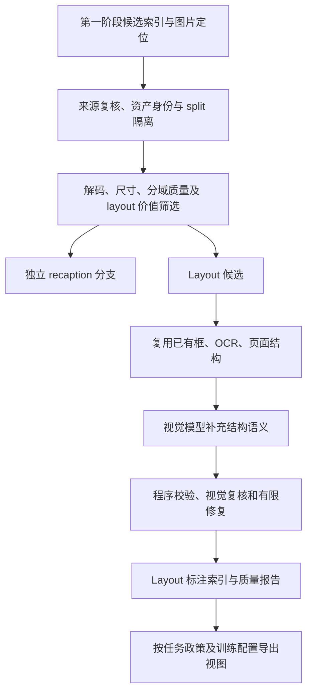

# Layout 数据筛选与结构标注阶段设计

更新日期：2026-10-22。状态：layout 生成和独立视觉复核已接入 [完整记录先导执行器](production/README.md)，当前等待 Qwen／Gemma 服务就绪，尚未完成真实批量生成验收。本文规定 layout 阶段的输入、分流、来源、标注和验收要求；来源索引入口 `python -m corpus_pipeline run/export` 不会执行这些步骤。这里的“合成”指对已有图像生成结构标注，不生成新的训练目标图像。

本阶段接在来源与结构索引之后，产出可追溯的高质量 layout 标注子集。它与 recaption 是独立分支：不要求每张合格图片都有 layout，也不在 layout 流程中为简单图片顺便生成 caption。第一阶段 `accepted` 仅是本阶段的候选资格，不代表图片已经通过解码、美学、来源复核或标注验收。

本阶段由 [总体架构](PIPELINE_DESIGN.md) 中的自动识别与路由流程按需选择，发布的是 **layout 标注及原图引用**。原集只读；不复制图片、不全量解包、不持久化一套裁块／缩放图。图像变换优先在内存和训练读取时执行，新增标注、诊断响应与临时空间均受存储预算约束。

现行来源政策以 [README](README.md#当前规则)、[PROVENANCE.md](PROVENANCE.md) 和 [rules.json](config/rules.json) 为准。DCVLM 保留原有任务、会话和交错顺序；T2I 训练候选仅从 gen-und 构建。本文不改变现有训练快照或导出限制。

## 1. 已确定的要求与待校准的参数

| 项目 | 本阶段约定 | 状态 |
|---|---|---|
| 图片来源 | 排除 AI 生成图；有明确真实原图血缘的 AI 编辑图可保留并标记 | 用户已确定，继承现行政策 |
| 非 AI 渲染 | 程序绘制的文档、文字、图表、CAD/3D 等不因其非摄影属性排除 | 用户已确定的过滤边界 |
| AI 文本 | AI caption、OCR、layout 等标注不因 AI 来源排除，保留生成来源及质量结果 | 用户已确定；layout 为该原则的应用 |
| 分辨率 | 原图短边 `min(width, height) >= 128`，另检查实际文字／结构可读性 | 用户最新统一硬规则；此前 480 建议不启用 |
| 视觉质量 | 要求高质量、美观；按摄影、设计、文档、UI 等域分别评价 | 用户要求；评分模型及阈值待校准 |
| 语言 | 支持中文、英文及中英混合；画面文字按原文保留 | 用户要求；语言比例待试点 |
| 标注范围 | 只为结构信息有价值的图片生成 layout；普通单主体图片交给独立 recaption 分支 | 用户要求；不机械按对象数量分流 |
| 标注模型 | 使用具备视觉输入能力的 Qwen、Gemma 模型 | 用户计划；具体版本、量化、输入分辨率和分工待实测 |
| 首轮规模 | 建议分层抽取 20K–50K 候选，先验收再扩量 | 试点建议，不是已运行或承诺的最终保留量 |
| 训练占比 | 根据有效标注数、域分布、资产曝光和训练收益确定 | 未确定；不引用 MOSS caption 比例代替 layout 比例 |

“原始图像”指可追溯输入版本，不能先放大再判合格。仅有文件尺寸不能证明图片未被上采样，应分别记录文件尺寸、已知原始尺寸、变换历史与未知状态。是否满足原始分辨率无法核实时保留待核验状态，不伪造分辨率证据。

## 2. MOSS 依据与本项目的适配边界

MOSS 对选定的高质量图像子集补充结构化 layout 标注，支持全局描述、局部元素、文字及位置等内容；公开报告没有给出足以复刻的逐类来源配比和保留数量。其 `scene/element`、`summary/items` 等表示方式可作为导出参考，不等于海报、信息图、UI 是三个已公开配额的训练子集。[MOSS §3.3](https://arxiv.org/html/2610.23374v1#S3.SS3)、[附录 C.3](https://arxiv.org/html/2610.23374v1#A3.SS3)

论文中的 JSON、字段、框范围等校验可借鉴，但结构通过不代表标注符合图像。推理阶段 Layout Planner 设计的是将要生成的画面；本阶段标注必须由已有图片约束，不能直接用规划提示词补画面中不存在的内容。[附录 C.2](https://arxiv.org/html/2610.23374v1#A3.SS2)、[附录 F.1](https://arxiv.org/html/2610.23374v1#A6.SS1)

MOSS 对早期联合质量过滤的观察，提示应防止误删含字图等域；它不等于禁止建设高质量 layout 子集，也不证明单独的分辨率门槛有害。这里的 128 短边来自用户规则，分域质量评价、模型分工和试点规模属于本项目设计。[附录 B.2](https://arxiv.org/html/2610.23374v1#A2.SS2)

## 3. 来源准入与 layout 分流

来源门覆盖所有图片角色和派生视图：

- **AI 生成图**：拒绝；例如 TextAtlas5M 的 `StyledTextSynth`。真实图或真实文字作为生成参考，不构成真实源图编辑例外。
- **AI 编辑图**：只有目标图与真实父图的编辑关系、父图来源均有依据时可保留，记录 `ai_edited` 和血缘。不得从同一记录中另一张真实图推断父图。
- **程序渲染及人工设计内容**：可作为候选，但需检查其中嵌入图像的来源。程序排版中包含 AI 生成插图的复合图不能因外层为程序渲染而放行。
- **未知或混合来源**：进入待复核清单；检测器低分或两个 VLM 都说“真实”不能替代来源证据。像素检测结果须有模型、版本、域内校准和决策依据。
- **AI caption／layout**：保留并标记，不把文字生成来源传播成图片生成来源。

分流依据是“结构标注增加多少有效监督”，而非单纯对象数：

| 图片情况 | 本阶段处理 |
|---|---|
| 单只动物、居中普通物品，没有重要文字或布局关系 | `recaption_only`：交给独立 recaption 阶段 |
| 单件商品，但含价格、卖点、标识和明确排版 | 可进入 layout；对象少不代表结构简单 |
| 单个人物海报，含标题、署名、分区和视觉层级 | 可进入 layout |
| 多对象场景，有明确位置、遮挡、人物关系或区域结构 | 可进入 layout |
| 多对象但严重模糊、关键区域不可辨识 | 不纳入高质量 layout；记录原因，其他任务另行判断 |
| 文档、信息图、UI，文字／区域关系清楚且目标分辨率可读 | 可进入对应域的 layout |

拟使用 `layout_candidate`、`recaption_only`、`layout_not_selected`、`quarantine`、`rejected_by_provenance` 记录本阶段路由，附原因码。`recaption_only` 不表示 caption 已生成；`layout_not_selected` 只表示未进入该子集，不改写原始记录的训练资格。新发现的 AI 生成证据则应通过来源复核与新版本索引影响该资产的所有相关视图。

原始 caption 缺失、过短或含 URL，不应单独决定图片是否值得生成 layout。仍需有可靠图像身份和本地引用；若因此在第一阶段隔离，先完成图片资产级解析或标注关联修复，不能直接绕过隔离状态。

## 4. 图像质量与目标分辨率

基础检查包括图像可解码、尺寸及方向一致、明显损坏、严重压缩或模糊，以及已有去重和评测隔离信息。这些是后续实施项，不能把历史的“文件存在”检查说成已完成图像质量检查。

美学筛选采用分域量表，阈值通过人工校准样本确定：

| 域 | 优先评价内容 |
|---|---|
| 摄影／场景 | 清晰度、构图、曝光、主体与空间关系 |
| 海报／广告／信息图 | 字体可读、视觉层级、对齐、留白、配色、元素完整性 |
| 文档／PPT | 区块组织、文字可读、阅读顺序、版面清洁程度 |
| UI／网页截图 | 控件和区域完整、文字清楚、布局一致性 |
| 程序图／图表 | 图例、标签、对应关系和可辨识性 |

通用 aesthetic 分数可用于低成本排序，不能作为所有域的统一准入阈值，也不证明图片非 AI 生成。保留 `aesthetic_quality`、`technical_quality`、`layout_value` 和 `text_legibility` 等分项，避免一个分数掩盖原因。[LAION 美学筛选说明](https://laion.ai/blog/laion-aesthetics/)

必须分别记录原图尺寸、标注模型实际输入尺寸／裁块、训练目标尺寸／变换。检查时，当前 [Q64 配置](../ascend_pretrain/configs/qwen35_9b_moss_q64.json) 的 `generation_max_pixels` 和 `vision_max_pixels` 均为 262144，面积约等于 512²，并非所有图片固定为 512×512。后续必须从实际训练配置读取此约束。

高分辨率文档缩放后可能无法辨认小字：只有满足对应训练视图的可读性要求才发布精细文字监督；否则进入更高分辨率候选、明确的局部裁块视图，或仅保留仍有依据的粗区域结构。局部裁块须记录父图、坐标变换和可见范围，不伪装成完整页面。包含文字的视图不默认水平翻转。

## 5. 候选来源及优先级

下表的本地状态来自既有存在性审计，不是本次全量复查；量级来自上游说明，不能相加为唯一图片数或筛选后数量。来源级“照片／收集图”描述也不构成逐图无 AI 的保证。具体镜像、版本、图片与标注完整性应在接入时登记。

### 5.1 优先从现有 gen-und 池筛选

| 来源 | 已知量级／本地状态 | Layout 价值与接入条件 |
|---|---|---|
| [ScaleCap-450K](https://huggingface.co/datasets/long-xing1/ScaleCap-450k) | 上游约 450K；本地曾确认图像，预期 caption 文件未定位 | 高分辨率、适中复杂度图片可作为试点；不是全量 layout 或逐图无 AI 认证。许可需核对，见下文 |
| [DenseFusion-1M](https://huggingface.co/datasets/BAAI/DenseFusion-1M)／4V 分支 | 百万级及约 100K 标注分支；本地 4V 曾数到 116,720 个 PNG，不能当成配对标签数 | 从 dense caption 辅助发现复杂场景，最终仍看图；版本与 DCVLM 同源图须归并 |
| laion-aesthetics-12m、OpenUni/LAION | 大规模候选池，本地图文存在；名称中的 12M 不是本次实测可用量 | 用于扩量；已有美学分仅作信号，补逐图来源、域和结构价值筛选 |
| [Megalith-10M](https://huggingface.co/datasets/madebyollin/megalith-10m) | 上游约 9.58M；现有 OpenUni 分支曾确认图片落盘 | Flickr 场景图可补对象布局；上游最低尺寸 256 的声明仍须逐图验证当前 128 硬规则和实际可读性；部分 `caption` 是 URL，使用实际 recap 字段或独立标注 |

OpenUni 的 raw/resized、TAR/解包目录和多种 recaption 版本先关联资产身份，不按多份图片扩量。`text-to-image-2M` 含 Flux／DALL·E 等生成分支，只能接收能够拆清来源且通过准入的图片。

### 5.2 待接入或先补标注的来源

以下完整数据及标注尚未在当前挂载中确认。新增外部来源保留真实 collection、revision 和来源血缘；登记为补源候选不自动获得 T2I 导出资格。需要纳入 gen-und 的后续版本时须明确输入清单与来源关系，不能靠改 collection 名称绕过当前限制。

| 来源 | 上游规模参考 | 用途与限制 |
|---|---|---|
| [TextAtlas5M](https://huggingface.co/datasets/CSU-JPG/TextAtlas5M) | 约 5M 的混合母池，不是 5M 合格非 AI 图 | 按子集拆分，详见下表 |
| [AnyWord-3M](https://huggingface.co/datasets/stzhao/AnyWord-3M) | 约 3M；中英文都有较大规模 | 自然场景文字、广告和商品文字；可复用 OCR 文字和多边形，需校验精度、结构价值并排除官方评测部分 |
| [PosterCraft/Poster100K](https://huggingface.co/datasets/PosterCraft/Poster100K) | 发布卡为 93K+，论文称 HQ-Poster-100K | 影视海报为主，可补排版；已有模型描述和区域标注。与明确生成的 Preference／Reflect 分支分开，后两者排除 |
| [Open Images V7](https://storage.googleapis.com/openimages/web/factsfigures_v7.html) | 带框训练图约 1.743M；不是全部约 9M 都有框 | 多对象布局、类别和框；需补语义描述，并筛美学和尺寸 |
| [DocLayNet](https://github.com/DS4SD/DocLayNet) | 80,863 页，其中训练 69,375 页 | 复用人工区域框、PDF 文本 cells、页面身份；原生文字需确认实际可见 |
| [RICO](https://bardiadoosti.github.io/Papers/aiforhci/rico.pdf)／[CLAY](https://github.com/google-research-datasets/clay) | RICO 原论文约 72K UI，发布子集需按版本核对；CLAY 59,555 个标注屏幕布局 | UI 元素及层级；CLAY 与 RICO 不能作为互不重合图集相加，清理不可见节点和模板重复 |
| [COCO](https://cocodataset.org/#format-data)／[Visual Genome](https://arxiv.org/abs/1602.07332)／[TextOCR](https://textvqa.org/textocr/dataset/) | 按实际 train split 和本地匹配数统计 | 优先为现有同源图片补框、对象关系、文字；作为校准和结构补充来源 |

TextAtlas5M 必须拆子集，不以“合成”一词一刀切：

| 子集 | 图像构造方式／使用计划 |
|---|---|
| `StyledTextSynth` | 含 SD3.5 生成底图，排除 |
| `CleanTextSynth` | 程序绘制文字，不因 AI 图政策排除；简单字图 layout 增益通常有限，优先其他文字任务 |
| `TextVisionBlend` | 程序排版及文图混合，优先复用排版信息；逐项审查嵌入图片来源 |
| `PPT2Details`／`PPT2Structured` | 幻灯片图像及描述／结构；适合区域和文字层级，不把两个标注版本默认算成两套独立图片 |
| `Paper2Text` | 页面文字与布局候选；评估训练尺寸下的可读性 |
| `TextScenesHQ` | 收集的含字场景；筛美观、结构价值和来源，不能凭名称免检 |

以上是子集接入方向，不是 TextAtlas 全量子集白名单；其他分支继续单独核验。[TextAtlas 构建说明](https://arxiv.org/html/2502.07870v1#S3)

接入台账须包含许可证据。研究时 ScaleCap 数据卡头部与正文／[作者仓库](https://github.com/Cooperx521/ScaleCap) 存在许可表述差异，后者包含非商业限制；Poster100K 标注为 CC-BY-NC-SA-4.0。两者先标记 `license_review_required`，不能仅凭可下载就视作可用于后续商业训练。其他来源按实际图片、标注和版本分别记录许可，不从合集许可推断所有上游资产许可。

## 6. 处理流程与 Qwen／Gemma 分工

1. **筛选先于昂贵推理。** 先做来源、尺寸、重复、split 和低成本质量筛选，再评价美学和 layout 价值。模型给出的评分需有分项依据和校准，不能把自报置信度当正确率。
2. **已有结构优先。** 将检测框、OCR 多边形、PDF／PPT 区块转换到统一坐标；保留原始标签和来源。人工框、机器框、PDF 原生文字分别记录，不能全部宣称人工真值。
3. **主模型补充语义。** 初始可试 Qwen 生成全局摘要、元素描述、文字外观、关系及缺失框；Gemma 做独立视觉复核。这个分工是待对照实验的起点，不预设哪家模型一定更强；具体使用支持视觉的版本。
4. **程序先校验。** 检查 JSON、字段类型、元素 ID、父子引用、框范围和面积、变换记录、文字标记等；解析修复不等于视觉内容修复。
5. **复核必须看图。** Gemma 或选定复核模型读取图片与待核验标注，必要时读取局部裁块、框叠加图；检查元素存在、框对齐、文字、读序和层级。只阅读前一个模型的文字回答不算视觉复核。
6. **按风险分配双模型预算。** 初期对分层样本做双模型及人工对照；批量阶段按文字密度、模型分歧、原生结构缺失等分配复核量，并持续随机审计。两模型一致不是正确性的充分条件，不要求全量重复生成两份标注。
7. **有限修复与隔离。** 配置有上限的结构修复和视觉重标注次数，记录每次输入与结果；仍不通过则隔离。重试次数待试点确定，不以无限重试凑合格率。

模型记录至少包含：模型及 revision、推理配置、prompt 版本／哈希、实际图像输入尺寸和裁块坐标、规范化结果、校验器版本、复核意见、重试记录、耗时与 token 数。原始响应按配置压缩留存并受配额和保留期约束；共享配置与 prompt 保存一次，通过 ID 引用，不在日志中重复保存图片。对有真实父图的 AI 编辑图，layout 必须对齐实际编辑后的目标图，不能直接沿用父图框。

## 7. 标注与索引契约

以下是待实现的契约，不是现有第一阶段索引已经具备的字段。采用独立 sidecar 索引，以引用关联第一阶段记录；原始索引、图像和 conversations 不原地改写。

| 字段组 | 最低要求 |
|---|---|
| 上游身份 | `input_run_id`、索引快照校验和、`sample_id`、`image_index`、collection/source/revision、原始 locator |
| 图片身份 | 独立 `asset_id`、字节／像素 hash（实际计算后填）、近重簇及证据；已有 `sample_id` 不能充当跨来源图片 ID |
| 来源 | 每图 image origin、编辑父图与证据、复合图嵌入来源、来源规则版本与复核结论 |
| 尺寸与变换 | 文件／已知原始尺寸、EXIF 方向处理、标注输入尺寸、训练变换、框对应的坐标画布 |
| 分流与质量 | 域、语言、各质量分项、layout 价值、本阶段路由、原因码及可读性结果 |
| 全局与元素 | 场景摘要、元素 ID／类型、框、可选文字及 polygon、可见属性、父子层级与有依据的关系 |
| 标注来源 | 字段或元素级 `human/source_annotation/programmatic/pseudo_label`、生成与复核模型、证据和版本 |
| 完整性 | `annotation_scope`、覆盖范围、缺失及不可读标记；部分标注不能标为完整场景 |
| 发布信息 | 标注版本、split、验证结果、选定训练视图、导出 schema 与变换版本 |

内部几何以明确画布上的像素 `xyxy` 为基准，OCR polygon 单独保存，EXIF 与 resize/crop 变换有记录。框格式和坐标空间是显式字段，不凭四个数字猜测 `xywh/xyxy/yxyx`。已有标注必须与准确图像版本绑定，不能把近重图片当成可直接互换标签的原图。

MOSS 导出另设带版本的适配器，区分 `scene/element`、`summary/items` 以及 normalized、absolute、centralized 等坐标空间；需要归一化或换轴时显式转换并检查。沿用既有 [总体方案的格式说明](../UNIFIED_MM_CORPUS_PLAN.md#72-固定一个内部格式再输出-moss-适配格式)，不混用“编译器输入草稿”和“已编译的模型条件”。

文字遵循逐字忠实原则：保留中文／英文原文、换行和读序；不自动纠错、翻译或补全不可辨认的小字。描述性 caption 可以选择中英文，画面中文字不能随描述语言改变。字体只能标有视觉依据的外观，未知具体字体名称不猜测。文字块、行与词等粒度明确，避免将不同层级当成重复对象。

同一张图的 caption、QA、OCR、layout 可保留多个有效标注视图，共享资产身份和 split，并控制总曝光。新建 layout 不自动增加采样权重，也不修改 DCVLM 的原生方向。`layout_to_image` 只能在当前政策允许的 gen-und T2I 候选中派生；`image_to_layout` 是独立的新标注视图，不覆盖 DCVLM 原记录。纯文本与原生交错记录不被拆散后伪装为独立 layout 训练集。

## 8. 实施、试点与验收

实施顺序：先完成本阶段输入／sidecar 契约与原生结构适配，再接质量筛选和模型生成／复核，最后接任务导出与训练 reader。每一步都发布独立版本，不能通过新增 JSON 文件宣称训练已经使用该字段。

首轮建议从 **20K–50K 候选图片**开始，按来源、摄影／设计／文档／UI 域、语言、分辨率和文字密度分层抽样，并单列简单图片作为分流对照。使用固定随机种子及样本清单，不使用现有目录前缀诊断抽样估计全库保留率。尚未完成来源接入的域可标为空缺，不能为填满配额引入未经准入图片。

试点须给出：

- 各来源和域的候选、来源拒绝、未知隔离、质量未选中、recaption 分流、标注生成和最终合格数量；明确分母，区分图片、记录、标注和视图。
- JSON／几何校验通过率，与独立视觉抽查的元素存在性、框对齐、OCR 忠实度、层级／读序正确率分别汇报；有人工真值时再计算相应 IoU 或文字错误率。
- 分层人工审核规模、抽样方式、审核分歧和误差区间；特别检查“模型互相同意但都出错”的情况。
- 128 硬门槛、质量分流对各域的影响，以及最终训练尺寸下的文字可读性；不只看原图。
- 唯一资产与近重簇数量、跨来源交集、评测隔离、同图多视图和计划曝光上限。
- 每千候选与每千合格标注的推理成本、延迟、失败／重试率、模型分工对照结果。

质量阈值、人工审核规模和发布目标在试点校准后写入版本化规则。未完成这些定义与测量前，不发布“工业级全自动合格”结论，也不把候选规模当成最终训练规模。扩到几十万或百万级应依据实测合格产出和训练收益决定。

生产实现需有输入指纹、模型／prompt／规则版本、确定性工作单元、断点恢复、原子提交及错误索引。CPU 的 gen-und 与 Ascend 的 DCVLM 存储不互通：执行器在能读取相应图片的分区运行，代码与索引显式传输；跨分区传递路径不等于传递了图片。发布 manifest 记录是否抽样、是否有未完成单元和可访问的图片定位。

当前交付限于本设计及入口关联；后续执行器、模型部署、图像解码／评分、layout 生成／复核和训练导出均需独立实施与验证。
