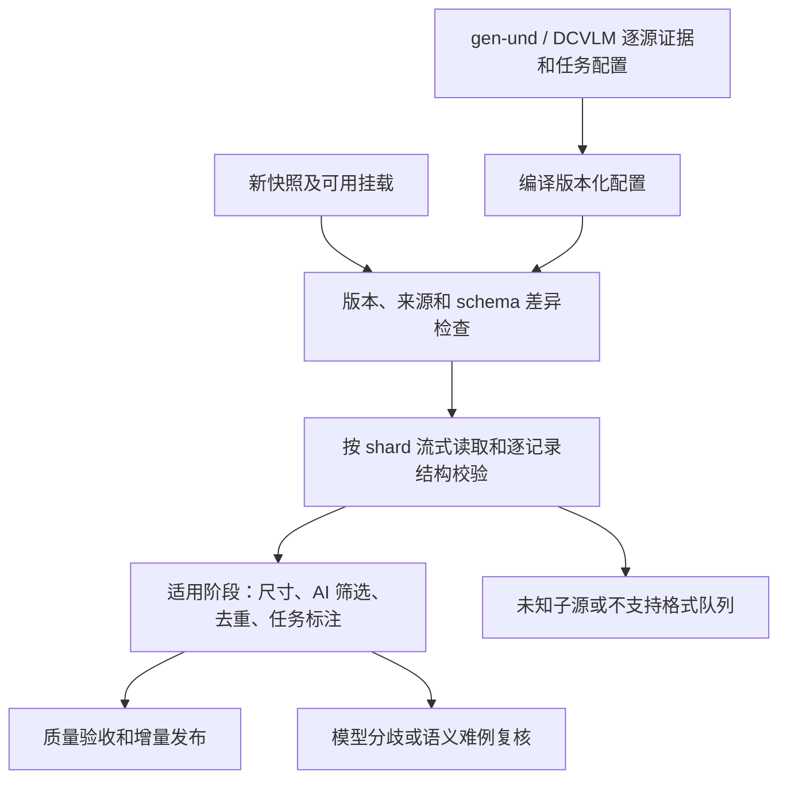

# 固定 gen-und／DCVLM 配置、按需处理、引用式发布的数据管道

更新日期：2026-10-22。按用户最新要求，范围固定为 gen-und 与 DCVLM，提前准备逐源配置，不建设任意数据集的 API 自动发现入口。SSCD 已实际验证，recaption、layout 与事务发布已接入 [完整记录先导](production/README.md)，真实模型阶段仍待端点就绪后验收；尚非全量工业调度器。当前入口见 [README](README.md)，新增配置与实测见 [prepared](prepared/README.md)，layout 细则见 [LAYOUT_PIPELINE_PLAN.md](LAYOUT_PIPELINE_PLAN.md)。

## 1. 用户目标与最终产物

目标使用方式：给定已支持的 gen-und／DCVLM 快照和挂载位置，加载版本化的逐来源／路径配置，校验 schema、图文关联与原生任务，执行适用阶段。来源页面已确认的制作方式、字段含义、任务家族提前保存，避免逐批调用 API 重复判断。新数据集在之后通过配置／适配器变更接入。

**原集只读，最终不再保存一份处理后的完整图片数据集。** 拥有复制权限不代表拥有复制容量。图片继续保存在原始数据源，新增 caption、layout、质量分数及任务视图等以独立增量文件保存；训练时按引用读取原图并组合标注。

部署时统一配置输出目录、存储与推理预算、API／本地模型、规则和分区访问方式；同一集合的新快照先检查来源差异和格式变化，再复用兼容配置，无需逐次手选每个处理模块。需要处理的是所有**适用**步骤，不是让所有样本都执行所有模型。

这是一份可复现的“训练数据清单＋新增标注＋读取规则”。它依赖原始图片持续可访问，不是脱离原集也可用的自包含副本。

## 2. 不可破坏的约束

1. 输入目录及其文件不修改、不删除、不原地补标注；解析器、库缓存和临时文件也不得写入源目录。输出位置须校验真实路径及符号链接关系，避免落入只读输入树。
2. 默认不复制原图、不全量解包、不保存全量 resize/crop 副本、不将图片 bytes/base64 嵌入结果表。裁块和缩放优先在内存中完成，必要临时文件有严格配额和清理策略。
3. 已有 caption、对话、交错文本和图像主要保存引用；只持久化新增或确需修正的标注。修正保存在增量层，原文仍可追溯。
4. 图像 AI 来源政策继承现行规则：拒绝 AI 生成图；真实父图血缘明确的 AI 编辑图允许保留并标记；未知来源隔离；AI 文本保留并标记。新增机器判别不能静默覆盖来源证据。
5. DCVLM 保留原生类型、方向和顺序；T2I 候选来自 gen-und。API 不得因为看见 caption 就自动反转 DCVLM 方向，也不得将独立 pair 拼成原生交错。
6. 不把程序生成图表、文字排版或 3D 渲染等同于 AI 生成图；复合图中的嵌入图片仍需来源核验。
7. 运行结果区分已完成、待处理、隔离、不适用、预算阻塞和解析失败。跳过昂贵步骤或不支持的子源，不能被记为“全部处理完成”。

## 3. 预先配置与运行时验证

预先准备字段映射、图片载体、父源及窄路径覆盖规则、原生任务家族、图像／文本制作来源、已有标注、已知重复家族、recaption 合同与 layout 候选策略。引用来源页和本地证据并锁定版本；“网页来源”“来源身份已知”不是“全部真图”。先有未知状态的配置也优于让 API 重复猜测；未解决的来源／适配器问题列入准备待办，不能直接发布。

程序仍须检查字段存在、引用、图文关联、角色和图像次序。单轮／多轮由角色结构确定，混合来源逐行路由；不能把目录一个标签强加给所有记录。目录级仅作汇总；描述任务与普通 QA 的语义边界由已知任务配置决定，混合语义样本才需要模型辅助。

运行时来源判断必须针对每个图片引用解析路径规则，保留明确 AI 负面证据及真实父图编辑的逐图血缘。纯文本跳过视觉链路，已确认的全 AI 子源提前停止视觉模型；确定性的图表／渲染来源可保护并抽检。网页和混合源仍逐资产检测，API 处理疑似、冲突和抽检。不确定不能被低检测分或 API 多数票改写为来源事实。

当前 `prepared` 编译器保存全量现有来源规则，并另列适配器待办；它不取代现有 policy 的证据优先级，也不意味着 634 条来源／路径记录全部完成来源验证。DCVLM-balance-200B 是未来新快照，须比较 source 列表、schema、样本结构和图片引用；不能继承当前小池的数量或推断其图片已挂载。

来源无法匹配、schema 漂移和标注缺失分别记录为未解决项；其余已支持子源可继续。新增语义规则或适配器通过版本化配置／代码处理，不执行模型返回的任意代码。

## 4. 按能力和依赖路由

| 识别到的内容 | 可能适用的处理 | 必须保留的语义 |
|---|---|---|
| 图像＋caption | 来源与图像质量、错配检查、去重、必要时 recaption | 保留原 caption；新增标注不冒充原文；任务方向服从 collection 政策 |
| 图像存在但 caption 缺失 | 验证图片身份，进入适用的 recaption／layout 候选 | “缺 caption”与“缺图像／来源不明”分开；恢复准入前不直接发布训练视图 |
| 单轮／多轮 QA | 保留消息，检查角色、图像引用、回答与上下文 | QA 答案不自动视为 caption；不反转成 T2I |
| 原生交错文档 | 顺序、图片引用、完整依赖、文本质量和切窗检查 | 不打乱图文，不因删除图片留下失效指代 |
| 纯文本 | 语言、文本质量、重复、split 和任务分类 | 跳过图片模型与 layout |
| OCR／文档／海报／UI | 复用原生文字和区域，评价可读性、结构价值，按需补 layout | 真实可见文字、读序、层级和坐标对应 |
| 已有检测／分割标注 | 几何适配、图像关联、语义补充 | 区分原生人工标注与机器标注；mask、框不是照片本身 |
| 简单主体图 | 合格时走普通图文／recaption | 不为凑规模生成冗余 layout |
| 仅 URL 或本地图片缺失 | 记录引用、缺失及后续需求 | 不假装可训练；不隐式下载全库图片 |
| 已知 AI 生成图 | 标记来源拒绝并关联受影响记录／视图 | 停止无用的昂贵标注；保留审计记录 |

具体计划由依赖关系决定：先核验引用和来源，再做适用的质量、去重、标注生成和复核；已有合格结果可复用。当前统一硬门槛为所有原图短边至少 128，无领域例外，不能放大后通过。Layout 额外考察实际可读性和结构标注价值；此前讨论的 480 尺寸建议不作为当前执行器的硬门槛。

任务路由有两层：数据集／子源层确定可用模块与字段映射；记录／资产层判断具体样本是否满足条件。一个合集可同时包含多个任务和多个处理分支，同一图片也可有多个有效标注。

## 5. 最终发布内容与原图引用

以下是目标输出契约，不代表当前已经产出所有文件：

| 产物 | 保存内容 | 不保存的重复内容 |
|---|---|---|
| 数据源登记与探测结果 | 来源身份、输入版本、分区、相对路径、结构证据、API 判断范围 | 原集副本 |
| 图片／文档／记录索引 | 稳定身份、原始定位、消息与图文顺序、关联关系 | 原图 bytes 和默认情况下的原文全文 |
| 决策与质量增量 | 来源判断、分项分数、保留／隔离／排除原因、处理状态 | 每轮运行重新复制全部历史元数据 |
| 新增标注 | 合格的新 caption、OCR、layout、修正及模型来源 | 与原集完全相同的已有文本或图片 |
| 训练视图索引 | 原始记录、图片、标注引用，condition/target、loss 和变换约定 | 为每个任务分别复制一份图像 |
| 发布 manifest 与报告 | 输入／规则／模型版本、分片校验和、覆盖率、split、计数、存储依赖 | 未经执行就声称全量成功的状态 |

引用必须能唯一回到实际数据，不能只保存容易变化的绝对路径或文件名：

- 散图：`source_id + source_revision + relative_path`，结合已有或后续计算的文件指纹。
- TAR：归档身份、成员名／序号、必要的成员偏移和长度，明确是否压缩。压缩 TAR 中的解压后偏移不是压缩文件的直接 seek 偏移。
- Parquet：文件身份、row group、组内行位置、列／内嵌图像位置；原始业务 ID 另存。
- JSON／JSONL 及对话：文件身份和稳定记录定位，以及消息、图像或片段序号。字节偏移只在相应格式与压缩方式支持时使用。

`sample_id` 是记录身份，`asset_id` 是图片身份，近重簇是相似关系；三者不能混为一谈。确切字节 hash 和像素 hash 只在实际计算或可信已有证据支持时填入；尚未计算时使用带来源版本的临时定位身份，不宣称完成全局去重。

同一图片可关联原 caption、新 caption、layout 和 QA，训练视图只引用这些标注。缩放、裁剪和任务选择保存为读取时执行的规则，同时保证坐标、文字可见性和 loss 语义一致。布局标注没有通过质量门，只影响相应视图；图片确认 AI 生成则影响该资产所有相关视图。

## 6. 存储预算是执行约束

不复制图片仍会产生可观的元数据：例如 1 亿条记录每条 1 KB，未经压缩约 100 GB；每条新增 5 KB 标注则约 500 GB。实际大小需抽样测量，不能把“只存文本”当成无需容量规划。

部署级配置应包含元数据持久化、模型产物、临时文件、可选缓存及日志各自的配额，以及预留空间和超限行为：

- 大规模运行前，按来源、标注类型和实际压缩结果估算新增与峰值占用，包含索引、状态库、并发中间结果及原子提交临时副本。
- 按分片流式提交，使用适合列投影／压缩的格式；集中保存数据集级证据、模型配置和长 prompt，逐记录引用其 ID，避免反复复制。
- 保存新增标注和变化的决策；新发布通过 manifest 引用未变更分片。后续增量实现不能以“新版本”为由复制所有旧索引。
- 原始模型响应、失败样本与诊断日志有独立配额和保留期；保留规范化产物及必要溯源信息，不在日志里持久化图片 base64 或每次重复的完整输入。
- 默认不开启持久化图片缓存；若为吞吐启用，仅允许配置了容量和淘汰策略的缓存。关闭缓存仍能从可访问原集正确读取。
- 触及预算时在安全检查点暂停受影响任务并报告 `blocked_budget`，不自动删除原集、已发布依赖或擅自扩大复制范围。中间状态和已完成产物保留以便续跑。
- 旧版本清理只针对可写输出区，先检查是否仍被发布清单引用；不能删除仍在使用的增量层导致训练版本失效。

GPU/NPU 推理预算与 API 请求预算同样受控。可基于固定输入、模型、prompt 和规则身份复用完成结果；不能因同图出现在多个数据包中重复付费生成相同标注。近重但非同图的结果不自动互用。

## 7. 读取性能与跨分区限制

训练读取器需要同时解析原始数据引用和新增标注。当前 `export` 只导出候选引用，不能因此声称已支持本文全部训练视图或后续增量层。

不复制图片时要利用原存储的读取特性：按 TAR 成员／分片顺序和 Parquet 行组组织工作，使用有界预取与 shuffle buffer；对压缩流采用适当的顺序调度。索引不能凭空把不可随机访问的压缩包变成低成本随机读取，也不能承诺引用式方案的吞吐等同于预先重打包后的数据。

CPU 上的 gen-und 与 Ascend 上的 DCVLM 存储不互通。图片处理任务应在能访问相应原图的分区运行，统一汇总索引和标注；每个 source 记录 `storage_domain` 与可用挂载／读取方式。训练开始前，在训练所在分区实测原始引用可解析且图片可读。

如果训练分区无法直接读原集，就需要平台支持的只读挂载、可用的远端流式读取服务，或在已明确容量内搬运选定部分。前两者依赖实际可用基础设施，后一种是有容量约束的例外，不是默认复制全库。若没有可行访问路径，标记 `source_unavailable`，不能只传一个索引就称训练可用，也不自动下载或跨分区复制图片。

原集只读不代表永久不变。发布清单记录源版本与指纹，读取时按策略验证；源文件变化、移走或失效时明确失败／隔离，不静默将相同路径的新文件当作旧样本。

## 8. 可恢复执行与质量验收

每个处理模块声明输入条件、输出契约、版本、依赖、适用任务和资源估计。执行状态按工作单元保存；重跑复用已完成且身份一致的步骤，规则／模型变化只重算受影响的部分。来源配置、复核建议和最终执行结果分开保存，计划中安排过的任务不等于实际完成。

整体完成标准包括：

- 实际识别的子源、schema 和原生类型有可核对证据，混合来源没有被单个样本概括。
- 所有计划内工作单元有成功、明确不适用或未完成状态；样本统计与全量结果分开。
- AI 图、编辑血缘、AI 文本标注与 collection 任务限制符合当前规则。
- 新增 caption／layout 的质量有独立验收；未获标注资格的图片不会为了补齐字段被伪造标签。
- 发布视图能从原始引用和增量标注恢复正确样本，图片／文本／多轮／交错顺序及条件目标正确。
- 训练环境能够读取相应 source，split 与资产曝光检查通过，源快照及产物版本可追溯。
- 运行过程中没有修改输入、全量解包或复制原图，持久化和峰值临时占用在预算内。

## 9. 当前实现与后续步骤

已有 DCVLM／gen-und 部分格式适配、来源和结构规则、任务分类、引用索引、检查点与候选导出；另有检测器校准、API 复核试验。本次增加固定来源配置编译和 DCVLM 原始图像只读 preflight，实际范围与结果见 [prepared/REPORT.md](prepared/REPORT.md)。

后续按依赖补齐：

1. 完善固定来源中尚未解决的标注关联和制作来源，验证新挂载／新快照。
2. 资产、记录、视图三层索引，便宜的精确去重与有界任务队列，串接已有 AI 复核协议。
3. SSCD 分域图像对校准、历史及本批索引、重复记录处理。
4. 大模型真实视觉 canary，按原任务生成／复核的 recaption 与精选 layout 分支。
5. 事务式增量发布、跨分区来源解析、训练读取器和端到端质量验收。

本次未重新启动大模型 Serving，未完成全库 SSCD 或 recaption，也未发布新训练集。来源规则和试验结果不能作为这些阶段已完成的证明。
