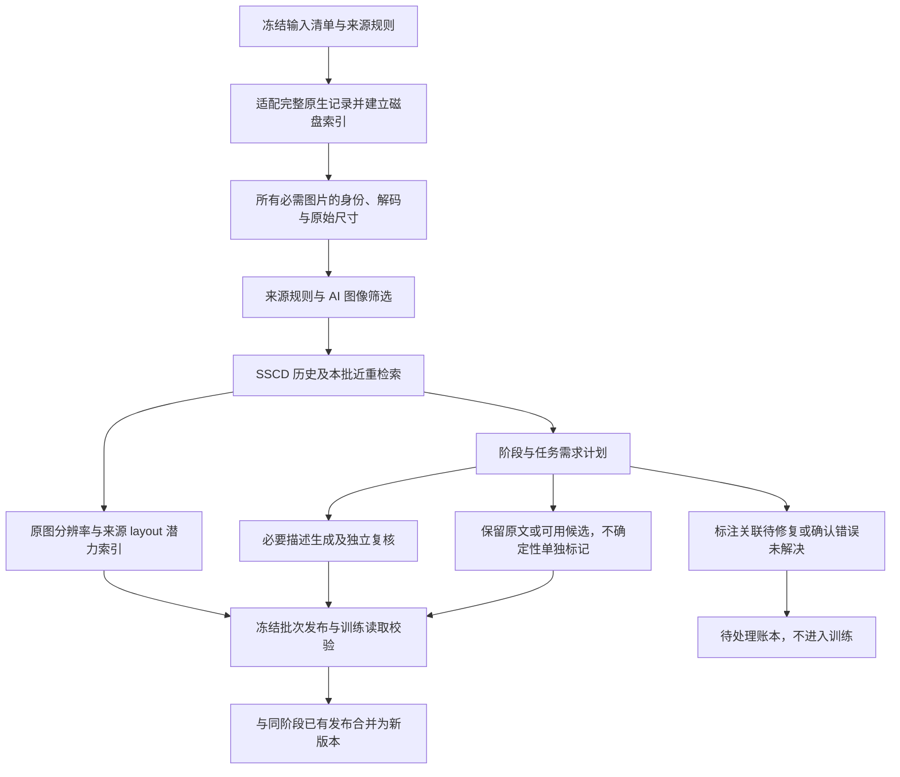

# 分阶段多模态数据处理管道 v2

日期：2026-10-23。本文说明重构后的执行流程、入口和边界；实际运行范围与结果见 [重构与真实验证报告](REFACTOR_REPORT_20261023.md)。当前早期阶段保留没有确认错误的原生监督，只补充确实缺失或确认错误的描述；分辨率和 layout 只做潜力索引。图像筛选现使用 `image_screening.v3`：mixed／unknown 来源进入检测流程，不再因来源标签本身被提前隔离。文中的命令是可复现用法，不表示已经运行对应全量任务。

新的主入口是 `production.staged_run`。它将输入索引、图片准入、描述需求判断、模型执行和不可变训练发布拆开，替代原来“每条合格记录都生成并复核”的执行方式。原数据只读，新增内容写入索引和 sidecar；DCVLM 保持原生方向，T2I 从适用的 gen-und 来源构建。

## 1. 实际执行顺序



1. **冻结输入。** DCVLM 使用原始父版的 manifest、catalog、完成标记及分片范围。校验来源、样本 ID、图片索引、成员名和文件指纹；不把单图从多图或交错记录中抽出来冒充完整样本。
2. **完整索引。** Parquet 按有界批次读取，SQLite 保存记录和图片来源关联。在所选输入完成索引后才执行后续阶段，以便同一精确图片在其他记录中出现明确 AI 生成证据时一并阻塞。
3. **图片门槛。** 每张必需图片验证原始字节 SHA256、长度、解码及尺寸。原始短边小于 128 直接排除，不放大后通过；多图记录不能丢掉不合格图片后继续训练。
4. **来源路由。** 明确 AI 生成图排除。具有真实父图依据的 AI 编辑图可以保留并标记；来源证据保护适用的程序图表、文档渲染、CLEVR 等。DataComp、ReLAION 等 mixed／unknown 来源进入检测流程：production 前置门只移除 `image_provenance_mixed`、`image_provenance_unknown` 两类来源未确认原因，结构错误、关联缺失、明确 AI 证据和尺寸不合格仍阻断。编辑图的真实父图未确立时仍待处理。
5. **检测与复核。** 未获得来源保护的图片使用 Community Forensics＋UniFD。完整且有效的检测结果无警报时按筛选策略准入，来源 `origin` 仍保留 mixed／unknown，不改成已证实自然图。有警报时使用 [v3 图像筛选提示词](production/image_screening_prompt_v3.txt) 调用 Qwen：有具体非 AI 证据、中高置信且本次决定无需额外外部证据时可准入；高置信 AI 且至少两条具体、独立的支持线索时排除；uncertain、编辑父图未确立或模型失败继续 pending。所有决定均是筛选回执，不是制作来源认证；多图记录的全部必需图片都须有准入回执。
6. **去重。** 精确资产身份与 SSCD 近重关系分别保存，复用历史特征；必要时看图复核近重对。相似关系不自动合并图片，也不自动删除 QA、多轮或不同任务的监督。SSCD 近邻不能作为共享 caption 的身份依据。
7. **需求计划。** 根据任务、当前阶段、配对状态、已有候选和质量证据决定保留或补写。早期绑定可靠、有可用文本且没有确认错误的原文及已有候选可以保留；模型不确定、细节不足、描述简短或文本来自 AI 不单独触发改写。
8. **执行及验收。** 仅对确实缺失或确认错误且没有可用替代的 caption 生成补充。模型输出保留真实 verdict、逐档检查和 concerns；早期不确定但未确认错误的结果可以标记后保留，不能冒充高质量覆盖。后期所选池仍要求完整 short、medium、long 严格验收，只给一个总 pass 不能证明三档覆盖。生成失败、没有可用文本或确认错误未解决的记录待处理。现有 QA、多轮、交错和纯文本不会被替换成 caption；已确认错误的原生 QA 暂存，不承诺自动修复。
9. **潜力索引。** 默认按实际原图尺寸和固定来源合同生成 `annotation_potential.jsonl`，不调用逐图 layout API，不自动选入未来高分辨率语料池。
10. **发布。** 每个批次保存全部输入的决策，准入记录形成引用原图的训练视图，并保留质量标记。发布前读取器实际核对原记录、候选回执和所有必需图像；新阶段或增量批次形成新版本，不改写旧发布。图像裁决按原始字节 SHA 绑定缓存，同一精确资产可继承所选输入中的已验证保护来源；不同图片不能借用保护证据。API 排除的资产进入撤销账本，作用于同次运行其他批次及合并的 base release，避免同图换一条记录后重新进入训练。

上述来源路由只属于完整 `process`／`production.staged_run` 执行器。基础 `run/export` 和 `policy.py` 仍只构建 stage1 来源／结构索引，其 mixed／unknown `quarantine` 表示等待后续图像筛选，不能作为最终拒绝，也不能只导出 stage1 accepted 后声称已经处理完整输入。历史 33 条样本中 17 条发布、15 条来源待处理的结果是在旧前置门下得到的，不代表 v3 的放行数量。

## 2. 两个阶段如何判断是否生成

| 情况 | `early_mixed` | `highres_1mp` |
|---|---|---|
| 原描述简短但可用 | 保留，不因短或来自 AI 强制重写 | 若缺少本阶段合格三档描述，补齐 |
| 已有可复用描述 | 按原任务、指令和绑定证据复用；不确定性保留标记 | 必须具备本阶段真实复核回执及完整短中长候选 |
| 真正缺少描述且已确认配对、字段检查完毕 | 直接生成，不再付一次“是否缺失”的判断费用 | 补齐本阶段描述 |
| 标注未定位、图片／文本关联不清楚 | `repair_metadata` | 同样先修复，不能用生成隐藏错配 |
| 疑似内容错误或模型 uncertain | 没有确认错误就保留并标记，不计高质量覆盖 | 待复核，不计为覆盖 |
| 已确认错误且没有可用替代描述 | 新增描述，停用错误文本视图 | 生成并重新验收 |
| QA、OCR、分类、多轮、交错、纯文本 | 保留原任务；视觉原监督可以按抽检策略复核 | 不自动进入 caption 补写池，也不替换正文或答案 |

当前潜力标签默认要求**原图面积至少 1,048,576 像素且短边至少 128**，面积可用 `--potential-min-pixels` 调整；未知尺寸仍记为未知，不以放大尺寸替代。它不证明视觉质量、caption 正确或适合 layout，待处理记录也可以带潜力标签，须同时查看 `training_admitted`。全部标签的 `future_highres_pool_selected=false`。

`highres_1mp` 是后期显式工程路径，约 1024² 指目标训练像素预算，不是一百万条样本。必须另行提供未来所选训练池的清单，当前 DCVLM／gen-und 不自动成为该池。仅显式输入的 caption 任务构成该次覆盖范围；原始尺寸、模型实际发送尺寸和训练目标分别记录。上采样不能补充不存在的细节。

覆盖必须由完整、可追溯的候选验收支持。仅有三条字符串、只把 `phase` 标签改成 highres、或者复用早期模型回执，都不能证明后期覆盖。多个分散的已审短／中／长候选目前也不会自动拼成一个已验收完整候选；需要形成经完整复核的组合标注。

原 caption 复核只作用于模型实际看见的原目标，不会将同一张图的其他候选也冒充已审。确认错误的原目标不会因为存在一个好候选而重新获得训练资格；早期仅有不确定性的原目标可以保留，但真实质量标记不会被好候选覆盖。来源、图像 AI、尺寸及图文绑定门仍独立执行。

## 3. DCVLM 与 gen-und 的输入支持

**DCVLM：** 支持完整父版 Parquet 记录、显式样本清单和分片范围清单。原生 caption 可直接映射；COCO、OpenImages caption、PixMo-Cap 的 conversation caption 使用固定来源、已观察指令及结构合同。无法匹配合同的 caption 来源进入元数据修复，不由模型临时猜测任务。原生 QA、多轮、交错与纯文本保留原顺序和目标。

**gen-und：** v2 完整执行入口目前接入三个明确的未压缩 TAR 合同：

| 来源 | 关联方式 |
|---|---|
| `BLIP3o-Pretrain-Long-Caption` | 同目录、同 stem 图片与 TXT；文本标记 AI 来源 |
| `BLIP3o-Pretrain-Short-Caption` | 同目录、同 stem 图片与 TXT；文本标记 AI 来源 |
| `laion-aesthetics-12m` | 同目录、同 stem 图片、TXT／JSON.caption；先排除纯 URL／路径占位字段 |

TAR 成员头和标注通过临时 SQLite 建立关联，不把成员顺序当配对依据，不完整解压图像。图片保持原 TAR 字节范围引用。缺标注、重复成员或歧义保留待处理状态；存在空 TXT 与完全未找到标注是不同情况。

这里的三个合同已做测试夹具验证。真实 gen-und 挂载验收是另一项验证，不能把测试夹具当成真实数据试跑。**21 个父来源的来源台账不等于 21 个来源都已具备 v2 完整读取适配器。** Megalith 六字段、其他 Recap、FineVision、编辑等已记录的来源，需要专用映射后接入；目前不由通用猜测器直接发布。

CPU 与昇腾分区存储不互通。在哪个分区执行，就必须在那里具备代码、依赖、规则、模型文件和原数据挂载；复制索引不代表复制了图片，也不能继承另一个挂载的路径有效性。

## 4. 使用命令

以下从仓库根目录运行，使用当前工程的 `.venv/bin/python`。默认原生 DCVLM 根目录已经登记在代码中。

### 发现并验证一个有界输入

```bash
.venv/bin/python -m corpus_pipeline.production.ingest discover \
  --source coco_caption \
  --max-shards 2 --rows-per-shard 64 \
  --output corpus_pipeline/runs/v2_inputs/coco_prefix.json

.venv/bin/python -m corpus_pipeline.production.ingest validate \
  --manifest corpus_pipeline/runs/v2_inputs/coco_prefix.json \
  --max-records 64 \
  --output corpus_pipeline/runs/v2_inputs/coco_input_validation.json
```

这些是来源分片前部的有界诊断输入，不是总体随机样本，不能用于推算全库质量比例。要覆盖全部指定来源，移除前缀限制，并为这次运行使用新的输出目录。

### 早期处理：调用已部署的 Serving

```bash
.venv/bin/python -m corpus_pipeline.production.staged_run \
  --manifest corpus_pipeline/runs/v2_inputs/coco_prefix.json \
  --output corpus_pipeline/runs/v2_early_serving \
  --phase early_mixed --backend serving \
  --endpoints corpus_pipeline/serving/endpoints.json \
  --batch-size 128 --io-workers 8 \
  --record-concurrency 16 --model-concurrency 16 \
  --audit-fraction 0 --layout source
```

这个入口使用平台**模型部署／Serving** 中已验收的端点，不创建训练 Job，也不会自动切到付费 API。生成与复核模型以端点登记表中的角色为准；Qwen／Gemma 的部署和资格检查沿用 serving 子目录的流程。

默认 `--audit-fraction 0` 保留可用原文，不做模型原文基线抽检；可显式增加该值进行基于样本 ID 的确定性抽样。它不等同于逐来源统计校准，也不关闭 AI 图像警报等必要分支。早期可用原文不会因可选审核调用失败或 uncertain 自动淘汰，失败与不确定性单独标记。

### 明确选择付费 Qwen API

```bash
.venv/bin/python -m corpus_pipeline.production.staged_run \
  --manifest corpus_pipeline/runs/v2_inputs/coco_prefix.json \
  --output corpus_pipeline/runs/v2_early_qwen_api \
  --phase early_mixed --backend api \
  --credential-example ../unified-mm/test_api.py \
  --generator qwen3.8-max --verifier qwen3.8-flash \
  --record-concurrency 32 --model-concurrency 32 \
  --audit-fraction 0 --layout source
```

凭据从示例代码静态解析，不执行示例，不写入模型回执。API 后端限制为 Qwen 系列，单独限制并发、合并完全相同的在途请求，并缓存精确请求。生成和复核是独立调用；两个 Qwen 角色不意味着其错误统计独立。供应商模型别名没有固定权重版本，这一限制随回执保存。

### 后期覆盖与候选复用

先将已发布的候选目录汇总为 JSONL，原有候选内容和回执保持完整：

```bash
.venv/bin/python - <<'PY'
import json
from pathlib import Path
source = Path('corpus_pipeline/runs/v2_early_qwen_api/batches')
target = Path('corpus_pipeline/runs/v2_inputs/early_candidates.jsonl')
seen = set()
with target.open('w', encoding='utf-8') as output:
    for path in sorted(source.glob('*/candidates.jsonl')):
        for line in path.read_text().splitlines():
            candidate = json.loads(line)
            if candidate['candidate_id'] not in seen:
                seen.add(candidate['candidate_id'])
                output.write(json.dumps(candidate, ensure_ascii=False) + '\n')
PY

.venv/bin/python -m corpus_pipeline.production.staged_run \
  --manifest corpus_pipeline/runs/v2_inputs/coco_prefix.json \
  --output corpus_pipeline/runs/v2_highres_qwen_api \
  --phase highres_1mp --backend api \
  --credential-example ../unified-mm/test_api.py \
  --generator qwen3.8-max --verifier qwen3.8-max \
  --candidate-catalog corpus_pipeline/runs/v2_inputs/early_candidates.jsonl \
  --model-cache corpus_pipeline/runs/v2_shared_model_cache \
  --audit-fraction 0 --layout source
```

上例仅演示工程接口，不代表选择当前 COCO 输入作为未来训练池。正式运行必须换成另行冻结的高分辨率训练池清单。输入早期候选可避免遗失已有描述，但不会将早期验收冒充后期验收；只有兼容后期任务、实际模型输入和质量合同的完整候选才计入后期覆盖。

### gen-und 明确 TAR 清单

在具有挂载的分区，将示例中的分片路径替换为实际存在的未压缩 TAR：

```bash
python3 -m corpus_pipeline.production.genund_ingest \
  --root /inspire/dataset/gen-und-mm-pretrain/01 \
  --source BLIP3o-Pretrain-Long-Caption \
  --tar BLIP3o-Pretrain-Long-Caption/path/to/actual-shard.tar \
  --max-records-per-shard 64 \
  --output /path/on/cpu/storage/genund_caption_input.json
```

随后将这个清单传给同一个 `production.staged_run --manifest`。`--tar` 可重复指定多个已确认分片；不会递归猜测所有父来源的格式。

### 延迟模型与训练读取验收

`--backend defer` 只延迟需要模型的分支；输入、图片、来源、检测器和 SSCD 阶段仍可能执行。没有可用替代且必须生成、或仍需图像来源裁决的记录保持 pending，不能伪称已通过。满足早期保留政策的原生或已有候选仍可发布，并保留未审／不确定性标记。

```bash
.venv/bin/python -m corpus_pipeline.production.reader \
  --release corpus_pipeline/runs/v2_early_qwen_api/dataset_release.json \
  --materialize
```

`--materialize` 会实际读取最终可训练记录的原图；不指定时检查聚合索引、批次和回执身份。训练代码使用 `reader.iter_training_records()`，无需自行拼接模型输出和原始对话。

## 5. 输出、断点和增量加入

| 产物 | 含义 |
|---|---|
| `run.json`、`state.sqlite` | 输入、代码、规则、参数身份；记录与精确图片来源关联 |
| `progress.json`、`summary.json` | 已完成批次和本次计数；不代表全库估计 |
| `batches/*/plans.jsonl` | 每条记录的阶段需求和原文／候选可用状态 |
| `batches/*/results.jsonl`、`pending.jsonl` | 执行、失败、待恢复和待审的明细 |
| `batches/*/candidates.jsonl` | 新增或导入候选，绑定图片、任务、原记录和模型验收回执 |
| `batches/*/ai_evidence.jsonl` | 来源保护、检测及 API 复核证据；筛选准入不改写原始来源标签 |
| `batches/*/dedup_relations.jsonl`、`pair_reviews.jsonl` | 近重关系与独立复核，不是删除清单 |
| `batches/*/annotation_potential.jsonl` | 原图分辨率潜力、来源 layout 路由、上游标注线索与独立训练准入状态；不自动选择后期池 |
| `batches/*/layout_sidecars.jsonl` | 显式 `--layout select` 的结构化标注及选择／验收状态；默认来源路由不生成 JSON |
| `releases/*` | 不可变批次视图、完整决策账本、回执和读取验收 |
| `dataset_release.json` 及配套 SQLite | 跨批次或同阶段增量的最终训练索引 |

相同命令和输出目录会检查完成批次的校验和并跳过已完成部分。代码、规则、输入、阶段或身份相关参数改变后必须新建运行目录。一个输出目录只允许一个活跃写入者。已完成但仍含 pending 的批次不会因重复命令自动改变判定；需要补足证据／模型后启动新的版本，可通过 `--model-cache` 复用完全相同的已成功请求。

增加新数据使用新的输出目录，并指定 `--base-release /absolute/path/to/same_phase/dataset_release.json`。只能合并同阶段发布；后期不能覆盖早期版本。新的待审／拒绝记录会遮蔽旧版本中同一逻辑记录的准入，避免纠错时回退到旧错误监督。记录、候选或图片级撤销通过 `--revocations` 输入带原因的 JSONL，保留旧发布的审计内容。v3 图像 API 的 reject 还会产生按 SHA 绑定的资产撤销，跨本次批次及 base release 生效；保护和缓存都不能覆盖明确负面证据。

候选数量不增加单条记录的训练曝光：读取器按原文／已有／新增来源组，再按允许的描述长度选一个视图。默认组权重相等，长度权重为短 0.25、中 0.5、长 0.25；这是版本化实现默认值，不是本次训练效果调优结论。任务混合比例和同图跨任务的总体曝光预算仍需要在训练配方中控制。

## 6. Layout 与规模边界

默认 `--layout source` 使用 [layout_source_contracts.json](prepared/config/layout_source_contracts.json) 的精确集合／来源匹配，仅输出 `layout_candidate`、`not_default_layout`、`sample_to_decide` 三种来源路由，不调用逐图 API，也不生成 layout JSON。合同覆盖 165 个 DCVLM 来源及 21 个 gen-und 一级来源；页面依据见 [来源调研](research/LAYOUT_SOURCE_ROUTING_20261023.md)。未知或混合来源排入来源级抽样待办，不逐图自动付费判断。

来源页面能说明上游是否有框、文字几何、HTML、scene JSON 等结构标注，因此优先恢复已有标注。186 条合同均尚未证明本地结构标注已绑定，必须继续验证本地文件、图片 ID、版本、裁切和坐标系。来源候选不等于单图高质量，也不是 MOSS layout 质量认证；`upstream_annotation_claim` 与 `local_recovered_status` 分开记录。

显式 `--layout select` 才对已准入的 chart、document、rendered 域候选执行图级选择、生成和复核布局 JSON。未选择、无法确定或验收失败保留各自状态。Layout 不要求先重写 caption，也不会自动插入原 QA 或交错正文；当前选择规则不是已经用 MOSS 高质量样例校准完成的准确率承诺。

当前实现有输入批读取、磁盘状态、受限 I/O 线程、记录并发、模型并发、精确请求复用和不可变发布；这些是可扩展基础，不等同于已完成十亿规模压测。

- SSCD 仍是单机历史索引与内存 HNSW 路径。正式大库需要分片、容量规划、持久化索引和检索召回验证，不能把小样本耗时线性外推为十亿规模承诺。
- 当前检测器缺失分数使用 CPU 推理，可能成为吞吐瓶颈。模型服务吞吐测试不能代替整个流水线吞吐测量。
- mixed／unknown 来源本身不再形成待处理积压；其图片需要完成检测，警报再进入 API。检测／API 失败、复核不能判断、编辑父图未确立和结构问题仍待处理。筛选漏检率、警报率与人工积压量须真实分层测量，不能因无警报就声称证明来源，或预先承诺未决项很少。
- gen-und 完整执行支持限于上述三个明确 TAR 合同，其他来源需要继续恢复标注并验证适配；DCVLM-balance-200B 挂载后须重新核对版本与 schema。
- 模型质量评估仍需分领域、语言和任务的人审基线。自动复核 pass 是可追溯的验收证据，不是“所有 caption 都正确”的证明。

核心实现：`production/ingest.py`、`genund_ingest.py`、`records.py`、`planner.py`、`potential.py`、`image_screening.py`、`stages.py`、`staged_run.py`、`state.py`、`api_client.py`、`staged_publish.py`、`reader.py`。历史试验记录继续保留，不应将旧先导结果与本次重构或 v3 图像筛选的实际结果混用。
