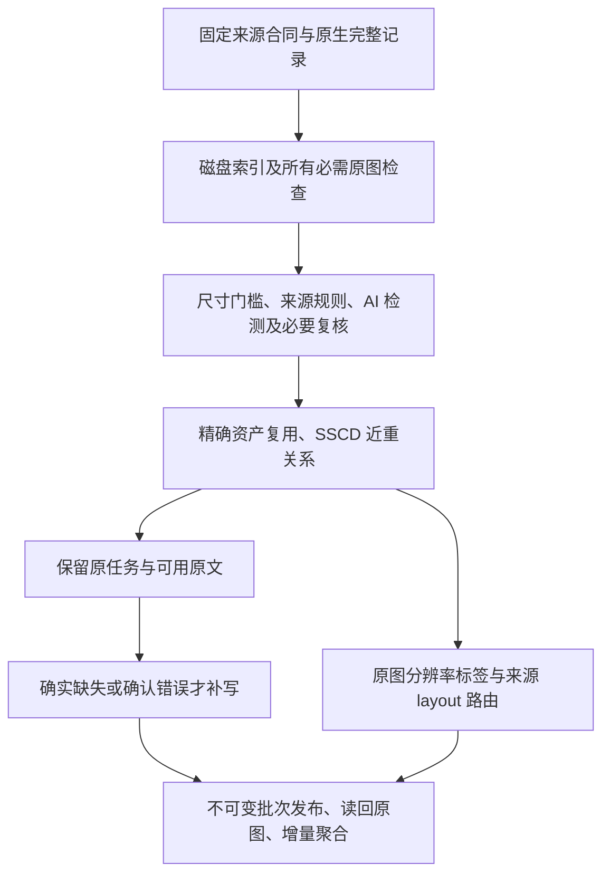

# 数据管道重构与真实验证报告

日期：2026-10-23。当前政策：**早期学习通用知识，已有文本只要没有确认错误就保留；后期高质量 recaption 另选数据池。** 本次完成可执行管道重构和有界真实 DCVLM 验证，没有启动全库处理。代码、来源配置、结果都在 `corpus_pipeline/` 中，原始数据未修改。

## 当前默认流程

1. **先确定来源和任务。** DCVLM 使用原始父版，保持 I2T、问答、单轮／多轮、交错与纯文本的角色和顺序；不恢复 T2I50。适用的 gen-und 图文来源提供 T2I。来源、任务与字段合同在运行前准备，不能确定的 schema 先修适配器，不逐条付费猜测。
2. **原图检查。** 所有必需图像都校验字节引用、SHA256、解码和原始尺寸，短边小于 128 排除。多图记录不能跳过其中不合格的图，放大后的尺寸不算通过。
3. **图像 AI 政策保持原口径。** 明确 AI 生成图排除；有真实父图依据的 AI 编辑图可保留并标记；程序图表、文档渲染、CLEVR 等不因非摄影而删除。来源规则保护适用数据，其余已通过来源门的图使用 Community Forensics＋UniFD，警报进入视觉 API 复核。来源未知、冲突或仍需证据的图继续待处理；文本的宽松政策不等于放宽图像来源门。
4. **去重保留任务价值。** 精确相同图片复用资产身份；SSCD 保存与历史、本批资产的近重关系，必要时看图复核。不会仅凭相似度删除另一道 QA、多轮对话或交错记录，也不会将近邻的 caption 当作当前图的标注。不同监督可以共享图像，训练曝光仍按记录／任务配方控制。
5. **早期原文优先。** 简短、AI 生成、细节不足、模型“不确定”，都不是自动重写理由。绑定可靠且有文本的原文及已有候选可以保留，附 `retained_with_uncertainty`、真实 verdict 和质量标记；不伪称高质量覆盖。只有确实缺失文本或确认语义错误、且没有可用替代候选时才新增描述。问答、多轮和交错正文不会被统一改写为 caption。已确认错误的原生 QA 暂存，当前没有自动修复所有 QA 的能力。
6. **只做廉价潜力索引。** 默认 `--layout source --audit-fraction 0`。每条记录输出原图分辨率、recaption 潜力、来源 layout 路由及原有结构标注线索，不调用逐图 layout API，不生成 layout JSON。只有显式 `--layout select` 才启动图级选择、生成和复核。
7. **发布和追加。** 新增索引／sidecar 引用原数据，发布前实际读回原记录和所有图。批次可恢复；同阶段新输入通过 `--base-release` 形成新版本，保留原版本及撤销记录。图片或候选被撤销后，不能因合并旧发布重新出现。

## 当前分辨率标记与未来 1MP 阶段

本次新增的 `annotation_potential.jsonl` 默认以**原图面积 ≥ 1,048,576 像素，同时短边 ≥ 128**标记分辨率潜力。`--potential-min-pixels` 可以调整面积标准；不要求图片是正方形。缺少原图尺寸记为未知，不用声明值或模型缩放尺寸替代。

这个标记只说明分辨率具备潜力，不证明视觉质量、caption 正确或适合 layout。待处理图也可以有潜力标签，因此另存 `training_admitted`；不能把潜力数量当成当前可训练数量。全部记录的 `future_highres_pool_selected=false`，**不会把当前 DCVLM／gen-und 自动选为未来高分辨率训练池**。

后期 `highres_1mp` 路径保留为显式工程能力：必须另行提供所选池的清单，校验完整短／中／长描述及实际模型输入、质量证据。它不在当前默认运行中启动。本轮的小规模高分阶段代码验证也不是正式高分辨率语料选择或训练。

## 来源页面能替代哪些 layout 判断

新增 [来源配置](prepared/config/layout_source_contracts.json) 精确覆盖 **165 个 DCVLM 来源＋21 个 gen-und 一级来源**；依据和第一方链接在 [layout 来源调研](research/LAYOUT_SOURCE_ROUTING_20261023.md)。

| 集合 | 来源级 layout 候选 | 不默认做 layout | 待拆分／抽样判断 |
|---|---:|---:|---:|
| DCVLM | 12 | 34 | 119 |
| gen-und 一级来源 | 0 | 8 | 13 |

“候选”优先恢复原有结构标注；“待抽样”只排入来源级待办，不会触发每张图 API。gen-und 的混合父来源不能据一个子集的特点整源升级，所以目前没有整源默认 layout 候选。

可以优先恢复的标注包括：ChartQA／PlotQA／DVQA／FigureQA 的图表组件与数据、DocStruct4M 的结构文本与定位、RenderedText 的字符几何、WebSight 的 HTML/CSS，以及 COCO 的对象标注。CLEVR scene JSON 有场景结构价值，但不能直接当二维布局框。SynthDoG 可确认的阅读文本、DenseFusion 的空间文字描述也不等于完整 layout 真值。

**186 条来源合同的本地结构绑定均尚未验证。** 上游有标注不代表 DCVLM 镜像保留了标注；后续应优先按图像 ID、版本、裁切及坐标系恢复，再决定少量需要 API 的样本。这一阶段已实现来源索引，没有声称已恢复这些原始结构包或得到 MOSS 级高质量 layout JSON。

## 真实数据验证结果

当前最终早期运行：[early_source_verified](production/runs/staged_refactor_20261023/early_source_verified/summary.json)。输入来自实际挂载的 DCVLM 父版，包含 **18 个来源、33 条记录、33 个必需图像槽**；任务为单轮 I2T 28、多轮 I2T 3、交错 1、纯文本 1。它是覆盖路径的有界诊断清单，不是随机总体样本。

| 检查 | 结果 |
|---|---|
| 原生监督发布 | 17 条；6 条复用原 caption、11 条保留其他原任务 |
| 图像来源待处理 | 15 条；保留来源未确认／混合证据，未计成 AI 检测命中 |
| 原始尺寸排除 | 1 条 |
| 新 recaption／模型原文审核／layout API | 全部 0 |
| 来源 layout 标签 | 候选 12、不默认 3、待抽样 18 |
| 分辨率潜力 | 10 条／10 图槽；其中当前已准入 6 条 |
| 未来高分池自动选入 | 0 |
| 原生训练读回 | 17 条、16 图槽；原文、角色、顺序、方向保持一致 |

此次图片已实际读出、校验并解码，新计算了 16 个真实 SSCD 特征；8 张图的检测器分数复用了图片与模型合同均校验过的前期真实推理回执，另 8 张由来源规则保护，没有把缓存说成新推理。首次运行约 13.08 秒，恢复约 0.77 秒，复用 3 个已完成批次、0 次新 API；这不是全库吞吐基准。17 条准入记录不代表逐条人工确认无误。15 条来源待处理的占比不能外推全库。

重构过程中还验证了默认路径不常触发的分支，原始证据均保留：

- **实际 caption 生成及逐档复核：** 3 张 COCO 原图，Qwen3.8-max 生成与独立请求复核，共 8 次 HTTP（含一次修订及复核）；严格逐档审核后 2 条发布、1 条待处理。随后查看原图与三档文本，发现一条描述对容器材质的断言无充分依据，撤销该高分候选；最终 1／3 覆盖。此严格高分审核不用于否决当前早期可用原文，也不是模型总体准确率测量。
- **候选复用和增量追加：** 对剩余合格候选用 `--backend defer` 复用，0 次生成、0 次 API，合并后仍是 3 个逻辑记录，不重复扩大样本数，人工撤销持续生效。
- **AI 警报路径：** 真实 SA-1B 来源图片的 UniFD 分数约 0.9967，API 看图倾向非 AI，但仍需来源证据；保留待处理，没有用模型视觉印象伪造来源确认。
- **SSCD 近重复核：** 两张真实题图相似度约 0.954，API 发现网格／缺失单元不同，保留独立资产；该分支为审计测试，来源门未被绕过。
- **旧 layout 图级试验：** 对 8 条记录做过显式选择与生成，得到 2 条未选、4 条模型验收、2 条待处理，共 26 次 HTTP 尝试。这个开销和不确定性说明不应默认逐图走此分支；当前默认来源路由不重复这些调用。

历史 `highres_final` 使用过不足以逐档验收的旧审核形式，已被严格读取器拒绝，不能作为当前训练发布。可读严格结果为 `highres_checked`、人工撤销后的 `highres_reviewed` 及 `reuse_append`。旧运行与当前默认流程的证据范围分别记账。

最终 **264 项回归测试通过**，覆盖不确定文本保留、明确错误排除、未知图像来源不放行、多图完整性、候选回执绑定、发布撤销、训练读取与潜力标签。测试夹具只验证程序逻辑，未计入真实数据质量统计。最终读回、恢复、完整性及回归测试记录见 [source_policy_acceptance.json](validation/staged_refactor_20261023/source_policy_acceptance.json)；早期其他分支验收见 [acceptance.json](validation/staged_refactor_20261023/acceptance.json)。

## 接下来正式处理的边界

当前代码已有流式输入、SQLite 磁盘状态、受限 I/O／记录／模型并发、精确请求缓存、不可变发布和增量聚合，适合作为继续扩展的管道基础。**尚未完成亿级规模或全库吞吐验收**：SSCD 仍是单机索引路径，检测器缺少缓存时的 CPU 推理可能成为瓶颈；真实质量统计需要按来源分层抽样。

DCVLM 完整原生记录已在真实挂载上验证。gen-und 当前仅实现 BLIP3o Long／Short 与 laion-aesthetics 三个明确的未压缩 TAR 图文合同，并通过结构夹具测试；**本次没有真实 gen-und 挂载验收，不能宣称 21 个父来源均已接入完整执行**。其他来源和未来 DCVLM-balance-200B 挂载后还需核对版本、schema、原始标注及来源合同。两个分区存储不共通，代码与依赖需在执行分区分别准备。

使用方法、输出定义及并发参数见 [PIPELINE_V2.md](PIPELINE_V2.md)。本轮没有新建训练 Job 或模型部署任务，真实模型验证使用已授权的 Qwen API，未使用 Kimi；Serving 后端继续连接平台的模型部署端点。
