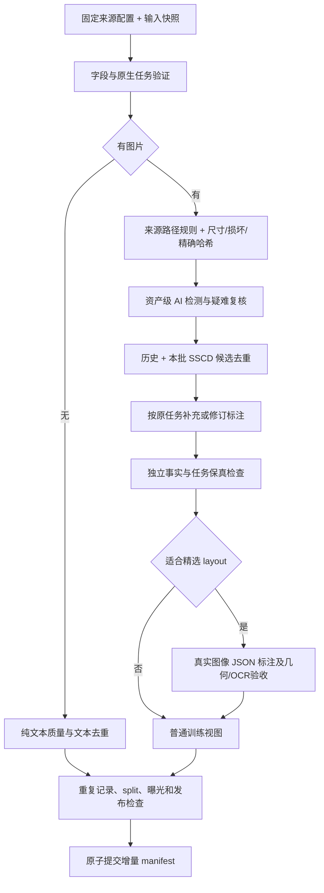

# 固定 gen-und／DCVLM 的数据管道优化与先导结果

日期：2026-10-22。范围：现有 DCVLM 做先导，未来正式处理 gen-und 与 DCVLM-balance-200B。来源和图像政策以用户当前要求为准：排除 AI 生成图；有明确真实原图血缘的 AI 编辑图保留并标注；程序绘图、扫描文字、普通 3D 渲染不因“不像照片”而排除；AI caption 保留并标注。DCVLM 保持原生任务，T2I 来自 gen-und。

**建议采用“预先准备逐源配置＋运行时确定性检查＋困难样本模型复核”。这个方案可以实现，但不能仅凭更大的模型或多个 API 一致就保证全部判断正确。** 本文的初次先导为只读来源／尺寸检查；后续已增加实际 SSCD，以及完整记录的标注、质检、layout、增量发布执行代码。模型服务仍在部署，尚未完成真实模型端到端验收。当前状态与执行入口见 [完整记录先导](../production/README.md)，SSCD 实测见 [去重模块](../dedup/README.md)。

## 1. 哪些工作提前做，哪些必须逐样本做

固定两套输入后，没有必要让 API 在每次运行时重新判断 JourneyDB 是什么、OmniCorpus 是不是交错、Infinity 的旧路径怎么改。为父源、子集和必要的窄路径分别保存配置，比通用自动发现更便宜，也更可审计。

| 预先准备、版本化保存 | 运行时验证与执行 |
|---|---|
| 来源页面、生产方式、原始图像家族、证据范围 | 当前文件／记录是否对应这个版本和子源 |
| Parquet/JSON/TAR 字段、图片和标注关联、旧路径映射 | 字段类型、图片引用、配对、缺失／损坏／压缩包不完整 |
| 原生任务家族、是否混合、多轮角色解释 | 逐条 role/turn/image order；不调用 API 数轮次 |
| 全 AI 子源拒绝、确定的程序绘图保护、编辑血缘要求 | 混合网页图片检测；每张编辑目标的真实父图关联 |
| 已有有效 caption、OCR、框、检测特征及其版本 | 当前记录是否真的有这些标注、是否与图片一致 |
| recaption 任务合同、layout 候选域 | 当前图文事实正确性、可读性、layout 标注可行性 |
| 原图家族重合、官方验证／测试来源 | 精确同图／同记录、SSCD 近重与 split 交叉 |

当前来源清单包含 **165 个 DCVLM 父源、21 个 gen-und 父源，以及 448 条 gen-und 内部来源／生成分片记录，共 634 条配置记录**。这是配置覆盖数，不是 634 个独立数据集，也不是 634 条已经获得真实图白名单。

现有来源登记中 **470 条是 `unknown + unresolved`**，其余还包含来源声明的 mixed/unknown；很多条目可确定任务或路径，却不能确定全量图片制作方式。必须把“来源已登记”“适配器可读”“制作来源有证据”“可发布训练”分成不同状态。编译器保留所有原规则、证据及窄路径覆盖关系；不会把 unknown 变成 allowed。21 个 gen-und 父源的实际准备内容见 [逐源路由说明](../research/GENUND_PREPARED_ROUTING_20261022.md) 与 [配置](config/genund_source_contracts.json)。

几个应直接固化的例子：

- JourneyDB 两个副本是明确生成图来源，直接排除其训练目标，不花钱 recaption；MJHQ 还具有评测用途。
- `Stable_Diffusion_3_Recaption` 的名字不是 AI 图片证据：它包含原图重描述，不能按文件夹名拒绝。
- OpenUni/Megalith 的通用 caption 有时是 Flickr URL，应关联已观察到的六个模型描述字段；不能把六条描述算成六张独立图片。标注配对适配未验收前不发布。
- Infinity 的旧绝对路径映射可提前配置，但路径存在仍不等于图文语义配对正确。
- FineVision／LLaVA／Infinity 等混合集合必须保留子源规则。上层 mixed 标签不能覆盖里面的明确 AI 分支，也不能让一条生成分支把整个父集合全部拒绝。
- UniWorld 的编辑任务逐目标检查真实父图；记录里同时有一张真图不能证明所有其他图都是基于它编辑的。
- DCVLM 的 OmniCorpus/MINT 保留原始图文顺序；caption、视觉 QA 和纯文本按已有格式与角色分流，不再重建 T2I50。

未来 balance-200B 即使来源名称相同，也必须比较来源集合、schema、图像引用和快照指纹。当前来源统计的一部分历史证据来自已退役 T2I50 的发布回执，仍可用于来源／format 调查，但**不能继承其 caption 方向，也不能套用其数量到 balance-200B**。

## 2. 推荐流程及顺序

任务家族提前知道，逐记录验证放在开头，才知道尺寸门槛、缺失图片和后续标注会影响什么任务。明确生成图的来源可先拒绝；其他图片仍先完成便宜的尺寸检查再进入检测器。廉价精确 hash 尽量与读图合并，复用同图已完成结果；不要每个来源把相同图片重新跑一遍昂贵模型。

最终分别索引三层：`asset` 是图片及其制作证据，`record` 是原始问答／文档／图文 pair，`view` 是某个任务下选用的原文或新标注。同图多条监督必须保留关联；caption 重生成不改变原记录身份。

多图记录必须检查所有被引用图片。只抽一张不能认为全记录通过。如果其中一个必需图片被排除，原多轮／交错记录不能直接删除那个图片 token 后照常入库；先隔离整条，只有能证明独立且指代完整的子序列才可作为另一个派生视图。网页装饰图是否可忽略，应由显式结构规则决定。

## 3. 尺寸：全局原图短边至少 128

用户已确定 **`min(original_width, original_height) >= 128`** 为当前统一硬门槛；128 恰好通过，127 拒绝，照片、图表、文档、字符、渲染和编辑图均无例外。多图记录任一必需图不合格则不发布该完整记录。图片尺寸在模型预处理前检查，不能用 resize 后的大小代替原图大小。长宽比、有效像素和任务可读性仍可形成额外质量信号，但不改变这条硬规则。

此前对已有 2,396 个分层抽样图像执行只读 preflight，重新读取原始 TAR 的 584,560,382 字节，全部 SHA256 与尺寸匹配；详细执行结果见 [summary](../runs/prepared_dcvlm_preflight_20261022/summary.json)。下表保留当时严格 `min(width,height) < threshold` 的候选门槛统计；原回执不追改。当前从中选定 128 为硬规则，其他数值仅供历史比较。

| 短边门槛 | 原始 TAR 实测的候选排除数 | 占该分层样本 |
|---|---:|---:|
| 64 | 119 | 4.97% |
| 128 | 183 | 7.64% |
| 224 | 344 | 14.36% |
| 256 | 416 | 17.36% |
| 384 | 773 | 32.26% |
| 480 | 1,062 | 44.32% |
| 512 | 1,256 | 52.42% |

关联的 **2,428 条原始监督记录**覆盖 132 个来源：单轮 I2T 1,958、多轮 I2T 245、交错 225，没有生成 T2I。25 张图片关联多条监督，32 条额外关联完整保留。170 条多图记录仍有 1,038 个图像槽未检查；7 张多帧图片只解码首帧。试验明确不赋予全记录训练准入。纯文本不在这个视觉抽样集内，不能由此推断 DCVLM 没有纯文本。

本次复用冻结检测分数，得到无警报 2,362、疑似复核 30、保护来源审计 4；引用 46 条既有 API 结果，没有新增模型／API 调用。抽样图像此前已成功提取，这次全部可读不能用来估计全库损坏率。试验耗时约 6.15 秒，仅说明这批本地文件的读取，不外推正式集群吞吐。

这些是**来源／领域分层样本比例，不能外推全库损失率**。按当前 128 硬规则，这个样本中的 183 张图不合格；这也不是整条多图记录的淘汰比例。MOSS 的 192px 出现在多条件联合过滤消融，不是最终统一过滤标准。[论文附录 B.2](https://arxiv.org/html/2610.23374v1#A2.SS2)

后续可以统计不同分辨率分桶的任务覆盖，但不能自动提高硬门槛或添加来源例外。当前 DCVLM 不转换 T2I，正式 gen-und 挂载后仍须单独报告它在同一 128 规则下的实际影响。

## 4. AI 筛选：证据、检测分数、模型意见分开

来源确定的 AI 生成图直接拒绝；确定的普通渲染／程序绘图按来源保护并抽检；真实父图可核验的 AI 编辑图保留并标注。AI 编辑图的父图来源未知或混合则隔离，明确非真实父图则按当前政策拒绝。对 mixed/unknown，使用 Community Forensics＋UniFD 提供复核优先级，分歧或高分触发大模型／付费 API，无法判断继续进入人工队列。

已有 `CF384 >= 0.90 OR UniFD >= 0.95` 是 **review-only 暂定触发条件**，不是生产自动删除阈值；模型分数不是制作来源概率。不能只检查高分图就宣称其余全是真图，必须对低分、来源保护和来源拒绝集合做分层随机审计，监控漏检与误排。

此前 46 张 DCVLM API 试验图最终有 13 张仍 unknown；另有 5 张已知 AI 对照只出现 1 张强一致识别。这批是有选择的难例／对照，既不能估算全库 unknown 比例，也不足以宣称可靠召回率。因此“最终人工一定很少”目前不能保证。详见 [API 试验报告](../api_review/REPORT.md)。

付费模型第一轮只看图做保守描述和证据判断，后续再提供可核验来源证据，避免被检测分数诱导；分别保存意见、来源事实和决策。多个模型共享训练偏差，一致不等于独立统计证据。真实来源编辑的保留资格由父图／操作关联建立，不能靠像素猜测。

## 5. SSCD：去重图片，不丢掉不同任务

MOSS 说明采用 SSCD，但未公开其具体生产型号、阈值和索引参数。官方 SSCD 的 0.75 示例来自 DISC 图像对，不能直接拿来删除我们的文档／图表。[MOSS §3.1](https://arxiv.org/html/2610.23374v1#S3.SS1)、[SSCD 原作者实现](https://github.com/facebookresearch/sscd-copy-detection)

先用文件 hash、规范化像素 hash 找精确副本，再用 SSCD 找裁剪、压缩、缩放等近重候选。近重簇保留原资产及关系，只有确认可互换时才选择代表图；**同图不同问答、不同 caption、不同文档上下文仍保留有效监督视图**。完全相同的任务记录再单独去重。

图表、文档、UI 的同模板不同数字非常容易被相似度误伤，须追加 OCR／数字／局部差异比较。不要把裁剪图的 bbox、原图的 caption 或编辑前的描述未经核验迁移到代表图。SSCD 相似关系也不应无约束传递合并：A 近似 B、B 近似 C 不代表 A 与 C 能共用监督。

增量处理同时查询已发布索引与本批索引；并发作业提交时还要复查提交期间新加入的资产，使用版本比较／事务，避免两批都查不到彼此而重复入库。训练／验证及保留评测集合先做泄漏检查；相同资产及近重关系不应跨 split 放行。

亿级索引要另算容量：512 维 float16 描述子每亿张约 102.4 GB（十进制，仅向量），float32 约 204.8 GB，尚不含 ID、ANN 结构和副本。采用分片、压缩和候选召回验证，不能把单机精确全量矩阵比较当成正式方案。现有 TAR 中若有 SSCD 特征，先核对权重、预处理、维度、归一化与图像绑定；同名 512 维不保证可直接拼库。

## 6. recaption 必须按原任务处理

| 数据类型 | 生成／检查方式 | 保留约束 |
|---|---|---|
| gen-und T2I pair | 看图生成短／中／长三个粒度的条件文本，原文另存；缺文字但图像合格的可进入 caption 恢复 | 不臆造不可见细节；一个图片资产，多个描述视图 |
| DCVLM I2T 描述 | 补充或修订描述回答，可保存多粒度候选 | 保持 I2T 方向，不转 T2I |
| 单轮 VQA／OCR／数学 | 看图＋原问题验答；仅在证据充分时产生修订版 | 不把“答案是 7”改写为整幅图片描述；保留原答案与修改原因 |
| 多轮 I2T／真实多轮 T2I | 输入完整必要历史，逐轮验证依赖、问题／目标和图片角色 | 不伪造额外轮次；不因文字更流畅而破坏前后指代 |
| 原生交错 | 保留原文段落、图片顺序和窗口依赖；图像 caption 存侧标注 | 不自动插入图像答案造成监督泄漏，不拼独立 pair 冒充交错 |
| 纯文本 | 文本质量、重复和任务保真检查 | 不调用视觉 recaption |

MOSS 推荐 Gemma 4 和 Qwen3.5-27B/35B-A3B；用户希望更强主模型，因此本项目建议更大 Qwen。短中长是语义粒度，短描述概括核心，中描述保留主体和关系，长描述尽可能完整记录可见信息；简单图片不能为了满足长度而虚构内容。[MOSS USERGUIDE](https://github.com/OpenMOSS/MOSS-Image/blob/52b87fca23acedc399d062d593bec388aee9926a/USERGUIDE.md#caption-model)

生成后至少检查可见实体、计数、关系、原样 OCR、问题可回答性和历史一致性。JSON 合法和模型自评分不是质量结论。原 caption 用作待核验参考，不能把它含有的错误传给所有新描述；独立复核应能回看原图。所有生成文字标注模型／prompt／processor／版本。

MOSS 原 caption:recaption 的 20:80 可作为 T2I 实验起点，有效三粒度 recaption 内再采样；它不是所有任务比例，也不是三份图片权重。保留原文只在原文质量合格时有意义，URL 不能进入“原 caption”采样。训练时控制资产总曝光，再决定任务与描述视图；多来源、多描述不能把同图权重无意放大数倍。[MOSS §3.2](https://arxiv.org/html/2610.23374v1#S3.SS2)

## 7. layout 单独精选，few-shot 使用真实标注

先筛 `visual_quality / text_legibility / layout_supervision_value / annotation_feasibility`，再对少量合格样本生成 JSON。图像漂亮与结构监督有价值是两个维度：清晰表单可能审美普通却很有用，漂亮单主体照片可能不需要复杂 layout。

MOSS 主页的 20 组案例是模型生成图及生成参数，可以隔离为 `synthetic_reference_only`，参考描述／布局的精细目标；**不是公开的真实训练图 gold，输入 prompt 也不等于输出图片正确的 OCR／坐标标注**。真实 image→layout few-shot 应从 DCVLM 挑选人审正例、反例和边界例后建立。[官方示例说明](https://github.com/OpenMOSS/MOSS-Image/blob/52b87fca23acedc399d062d593bec388aee9926a/assets/README.md)

标注必须从现有像素出发，不能套用“规划尚未生成画面”的增强 prompt。统一保存原图坐标、实体 ID 和读序；程序负责坐标转换，模型负责内容。分别验证 OCR、实体存在、框位置、越界和引用，失败只禁用该 layout 视图，不把原本合格图像一起删除。尚未确定的文字明确留空或 unknown，不能修辞性补全。

## 8. 大模型部署与高并发安排

当前执行 **Qwen3.5-397B-A17B BF16 主生成＋Gemma 4 31B BF16 复核／备选描述**。Qwen 复用已定位的公共权重；Gemma 已直连下载 62.58GB 并完成全文件 SHA 校验。已分别提交 32 卡 Qwen 与 16 卡 Gemma LOW Job；Gemma 使用四个 TP4 副本。两者目前均排队，实际镜像视觉能力仍需 canary，不能把权重齐备或提交成功当成上线成功。Qwen 另准备 16 卡 W8A8 资源收缩配置，换精度后须重新验证。[当前执行记录](../EXECUTION_20261022.md)、[前期只读核验](../research/ASCEND_SERVING_PLAN_20261022.md)

Serving 与数据 worker 分离：worker 在可访问原图的分区读数据，发图片／上下文到服务。CPU 与 Ascend 的文件系统不互通；服务不能仅凭一个 CPU 路径读取图片。未来挂载 ready 后先验证实际可读，不从“将来会挂载”推断今天已经可用。

付费 Kimi-K3 等用在疑似 AI、来源冲突、复杂 OCR／关系分歧、难交错和精选 layout 校准。GLM-5.3 等先做真实图像输入协议测试；模型名称出现在列表不代表当前端点接受图片。用分域误差和吞吐决定 Qwen/Gemma 分工，不要求每张图无差别跑完所有模型。

高并发由不同阶段的有界队列组成：读取／解码、检测器、SSCD 特征、VLM、质量复核、提交各自限流，按 TAR 和 Parquet row group 组织局部读取。按图像分辨率、视觉 token、文本长度分桶，观察成功样本每秒和 p95，而非只把客户端并发开大。限流、超时、模型 OOM 和 JSON 失败要有限重试，失败产物不能当成功缓存。

缓存键包含资产、原始上下文、任务、规则、模型／processor／prompt 版本；同图不同问题不能共用答案缓存。任务使用租约／幂等提交；输入清单只发现一次后分片，不让每个 worker 重扫全库。发布 manifest 原子切换，未完成、unknown 和不适用分开统计。旧冻结试验产物保持原样。

## 9. 质量验证与下一步实现边界

先冻结含照片、图表、文档、手写、渲染、真实来源编辑和生成图对照的分域人审集。AI 检测评估误排／漏检／unknown；SSCD 评估真正副本和同模板不同内容；recaption 评估事实、OCR、问题与上下文保持；layout 评估位置与文字。应包含低分随机图，而不只看检测器挑出的难例。

模型／规则升级后复跑同一验证集，并留出不参与阈值选择的集合；来源、时间和生成器留出用于检查泛化。只有在明确抽样方案和标签可信时才估计总体错误率。即使随机盲审 n 个样本零错误，常用近似的 95% 错误率上界仍约为 3/n，不能写成 100% 准确。

当前应先完成的工程顺序是：固定来源配置和未解决关联 → 资产／记录／视图索引及 AI 阶段编排 → SSCD 分域校准 → Qwen/Gemma 视觉 canary 与任务保真试验 → 精选 layout → 增量发布／训练读取端到端检查。小规模固定训练预算的原文／新标注对照，才能判断数据是否提升最终模型，不能仅凭 API 满意度下结论。

本次产物均在 `corpus_pipeline/` 下；新增 15 项边界测试通过，覆盖未知来源不放行、窄路径生成图拒绝、DCVLM 不反转、QA 不转 T2I、未来快照验证、原始字节损坏、同图多监督和多图检查范围。原图未删除、未复制全库，未恢复 T2I50，未启动大规模 Serving。配置准备和样本检查已经落地，全流程生产完成仍需上述阶段逐项验收。
